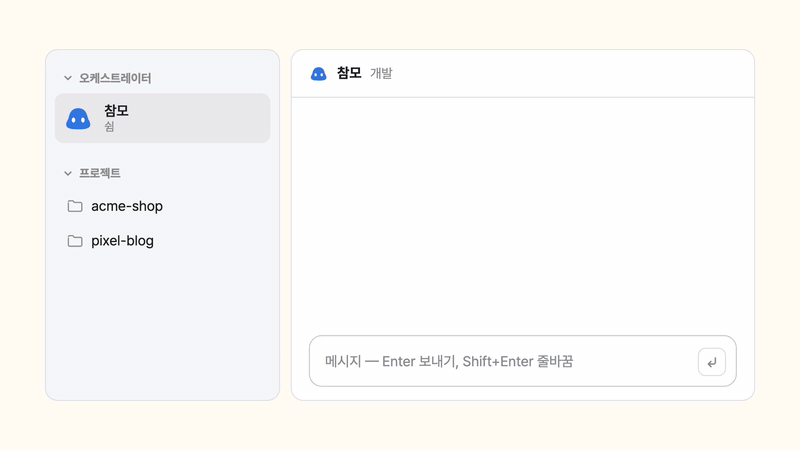
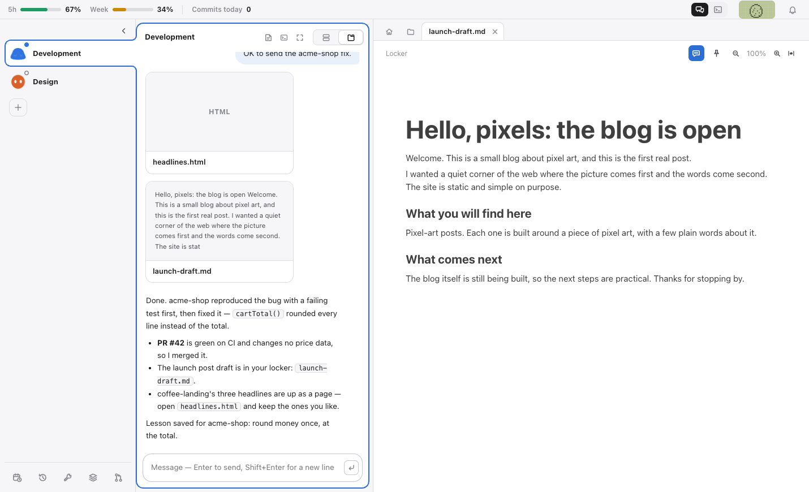
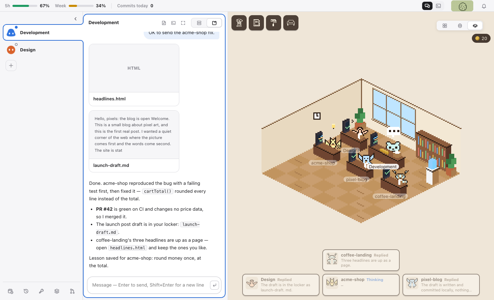
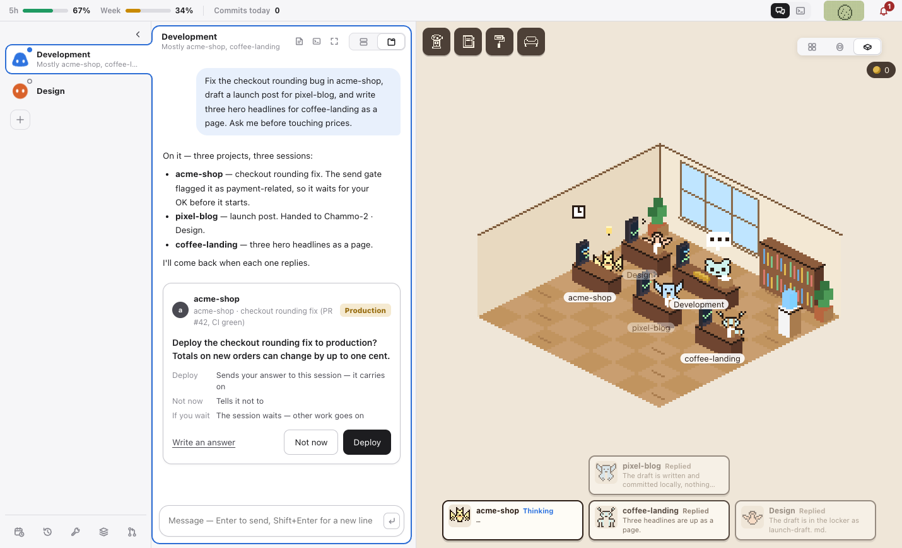
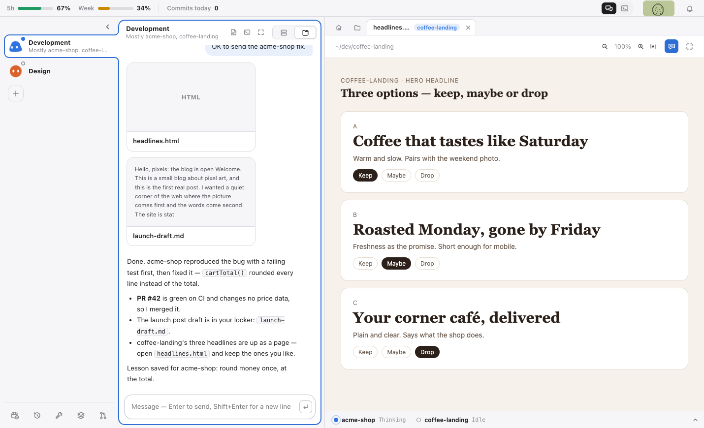
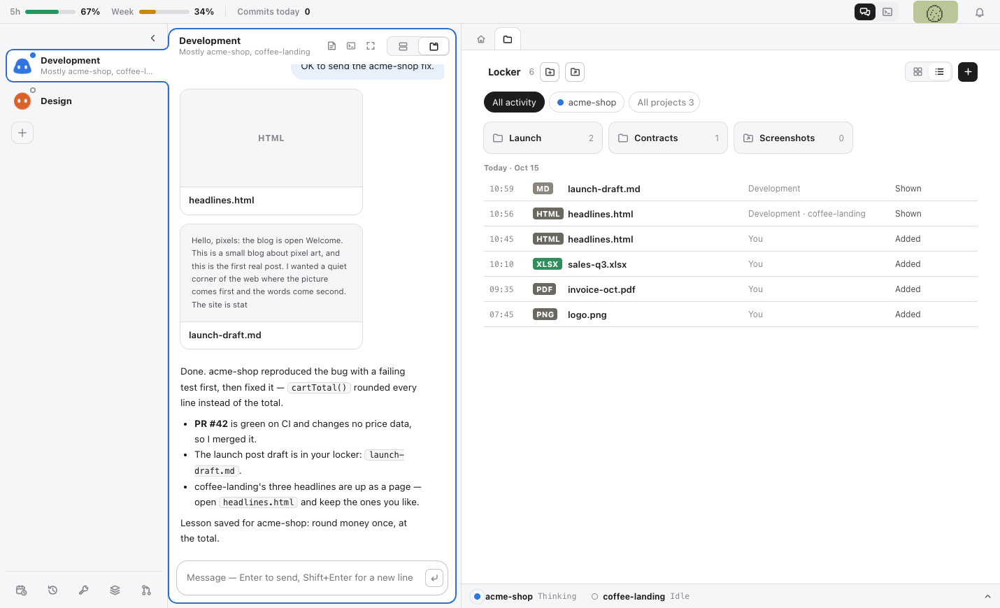
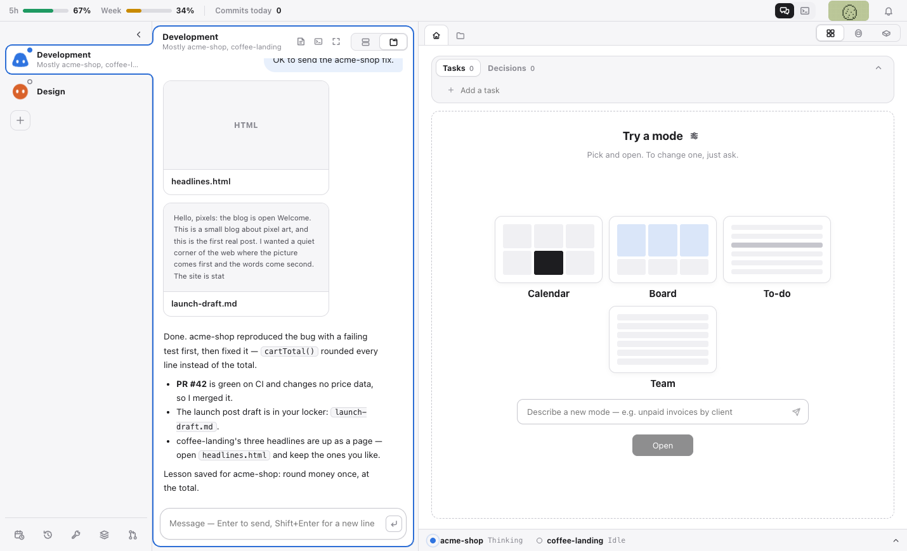
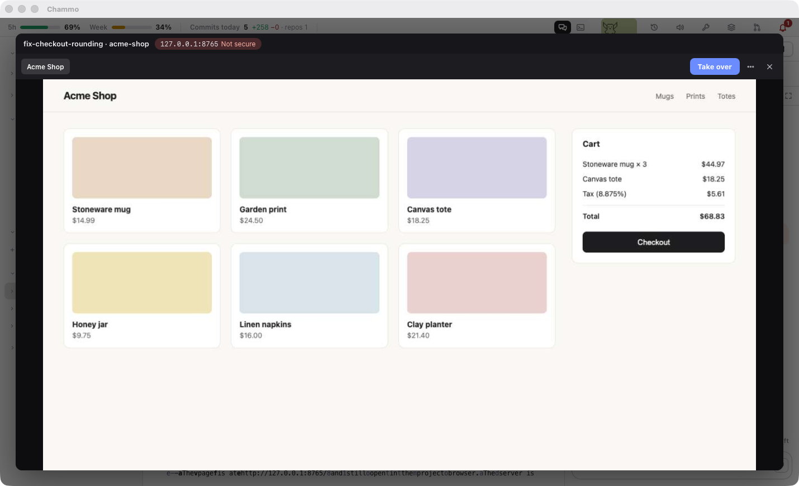
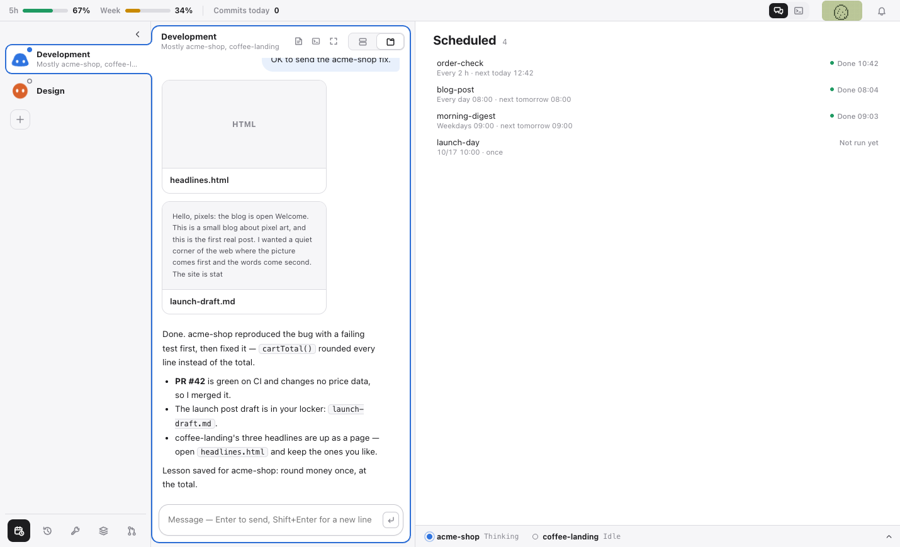

<p align="center"></p>

<p align="center"><a href="https://github.com/honorstudio/chammo/releases/latest"><b>다운로드</b></a> · <a href="https://chammo.app">소개 페이지·미리보기</a> · <a href="README.md">English</a></p>





**Chammo 참모는 내 클로드 코드를 팀으로 돌리는 무료 오픈소스 AI 참모 앱입니다.** 맥(14 이상)과 윈도우(10/11)에서, 내 컴퓨터에서, 내 Claude 로그인으로 돌아갑니다. 참모라는 Claude Code 세션 한 명과 대화하면, 참모가 프로젝트마다 백그라운드 클로드 코드 세션을 띄우고, 일을 나눠 맡기고, 결과를 읽고, CI가 초록이면 안전한 PR을 머지합니다. 되돌릴 수 없는 결정만 나에게 묻습니다. 세션은 전부 진짜 대화형 클로드 코드 세션이라 언제든 열어서 직접 입력할 수 있습니다. 모델 사용료는 내 Claude 요금제(Pro, Max 등)에서 나갑니다.


## 무엇을 할 수 있나

### 한 번 말하면 팀이 움직인다

참모에게 원하는 걸 글이나 말로 전합니다. 참모가 요청을 프로젝트별로 나누고, 도는 세션이 없으면 띄우고, 일이 돌아오면 한두 줄로 알려 줍니다. 화면은 셋입니다 — 왼쪽 띠(참모마다 프사 하나, 끌어서 순서를 바꿈) | 가운데 채팅 | 오른쪽 스페이스. 프사가 상태를 보여 줍니다 — 고리는 대화가 얼마나 찼는지, 점은 일하는 중인지 질문을 기다리는지.



### 내 결정만 내린다

돈이 움직이는 일(결제·환불·과금)은 보내기 전부터 당신을 기다립니다. 세션은 운영에 손대기 직전 — 운영 DB 마이그, 운영 데이터 삭제, 운영 배포, 실사용자 발송 — 에 멈추고 참모에게 묻고, 당신이 정할 일이면 참모가 결정 대기함으로 올립니다. 당신 본인의 승인 카드가 뜨는 건 결제뿐입니다. PR 은 CI 가 초록이면 참모가 머지하고, DB·돈·보안을 바꾸는 것만 당신을 기다립니다. 답은 채팅 속 카드, 종, 폰 어디서든. 다만 폰에서는 결제·운영·발송·삭제 카드를 내 Chammo 계정으로 중계에 붙은 폰만 누를 수 있습니다(이 컴퓨터 앱의 카드는 그대로입니다).



### 채팅 옆에서 읽고 검토한다

세션이 보여 주는 문서는 채팅 옆 스페이스에 탭으로 뜹니다. 마크다운은 고칠 수 있는 노션식 문서로(블록 끌기, `/` 로 넣기, 밖에서 고친 내용은 덮지 않고 합침), 엑셀은 칸을 바로 고치고, HTML 시안 검토·PDF·그림도 같이. 참모가 띄운 영상은 보다가 시각마다 말을 남기고 그 글을 참모에게 보낼 수 있습니다(폰도 같음). 탭은 확대·축소되고 배율은 파일마다 기억합니다.



### 파일 보관함 — 진짜 폴더

참모마다 보관함이 있고, 그건 진짜 폴더 `~/Documents/Chammo/<참모>` 입니다(파인더에서도 같은 모양). 파일을 끌어 놓거나 참모가 넣어 두고, 맥 폴더를 연결하면 원본은 그 자리에 둔 채 보관함에서 바로 보입니다. 폴더는 보관함을 처음 열 때 만들고, 그때 스크린샷 폴더(Windows 는 사진\스크린샷이 있을 때)를 '스크린샷'으로 연결하며 한 줄로 알립니다 — 맥이 문서·데스크탑 접근을 물을 수 있고, 연결은 언제든 풉니다(원본은 그대로). 지운 건 맥 휴지통으로 가고 방금 지운 건 되돌릴 수 있습니다. 보관함 맨 위는 '파일 · 링크' 두 칸입니다 — 링크 칸에는 그 참모와 주고받은 대화(사람 말·참모 답)에 나온 링크가 모이고, 주소를 직접 붙여 넣거나 목록에서 뺄 수 있습니다(빼면 되돌리기 알림이 뜹니다). 모으는 건 이 맥 안에서만 일어나 바깥으로 보내는 것은 없습니다.



### 내 화면을 만든다 — 참모 모드(미리보기)

모드는 화면이 달린 Claude Code 플러그인입니다 — 출시 체크리스트, 주문 현황판, 예약을 돌리는 버튼 같은 것. Chammo 가 진짜 패널로 그려 줍니다 — 따로 창, 옆 칸, 대시보드 칸, 팝업, 꽉 채우기. 참모에게 부탁하면(**모드 > 새 모드 만들기…**) 프로젝트로 만들어 줍니다. Claude Code 2.1.287 이상이 필요합니다.

참모마다 홈이 있습니다 — 할 일·최근 결정 줄 아래가 모드 칸입니다. 홈 머리의 격자 단추로 모드를 골라 켜고, 관리에서 숨기거나 지웁니다. 처음엔 맛보기 넷(달력·현황판·할 일·참모 상태)을 바로 켤 수 있고, 각자 스킨 셋 중에 고릅니다. 맛보기는 **한국어 견본**입니다 — 글은 한글이고 달력은 서울 시각·한국 공휴일을 씁니다.



### 지켜볼 수 있는 브라우저를 세션에 준다

설정의 **설치** 버튼 하나로 프로젝트마다 로그인이 유지되는 브라우저 프로필이 생깁니다. 앱 안에서 실시간으로 보거나 크롬에서 열고, 세션이 당신을 부르면(로그인·캡차) 브라우저 창에서 바로 답합니다. 크롬이 직접 띄우는 사이트 권한 요청과 '구글 계정으로 계속하기' 창은 앱 브라우저 칸에서 카드의 단추로 눌러 답할 수 있고, 알림 권한은 기본으로 막혀 있습니다. 번역 제안·비밀번호 저장 제안·다운로드 풍선처럼 크롬이 자주 띄우는 제안 풍선은 크롬 설정으로 꺼 둬서 칸에 뜨지 않고(비밀번호는 저장 제안만 끈 것이라 이미 저장된 비밀번호 채우기와 로그인 유지, 주소·카드 자동 완성은 그대로입니다. 대신 세션이 사이트에 친 비밀번호는 크롬에 저장되지 않습니다), 그 밖에 크롬이 자체로 띄운 창이 있으면 칸에 '크롬에서 보기' 한 줄이 뜨고, 꺼낸 창은 툴바의 '칸으로 돌려놓기'로 되돌립니다. 크롬 풍선의 닫기 단추를 칸에서 누르려면 맥 시스템 설정 > 개인정보 보호 및 보안 > 손쉬운 사용에서 Chammo 를 켜야 하고(꺼져 있으면 풍선 위 누름은 아무 일도 하지 않으니 '크롬에서 보기'로 다루세요), 윈도우엔 이 설정이 없습니다.



### 정해진 때 돌린다

"매일 아침 블로그 올리기", "2시간마다 주문 확인", 또는 정한 날짜·시각에 한 번. 앱이 꺼져 있어도 macOS(Windows 는 작업 스케줄러)가 예약을 깨우고, 매번 진짜 Claude Code 세션이 일하고 보고합니다. 시작하다 실패하면 15분 뒤 한 번 다시 돌리고, 멈춘 예약은 참모에게 알립니다.



### 사무실을 둔다

세션마다 책상에 앉은 픽셀 캐릭터가 있습니다 — 출근하면 걸어 들어와 앉고, 고칠 땐 타자를 치고, 읽을 땐 서류를 읽고, 명령을 돌릴 땐 진행 막대를 봅니다. 일해서 번 코인(머지·시킨 일·테스트 든 커밋 등)은 캐릭터·가구·바닥 장식·벽 장식이 나오는 뽑기에 쓰고, 참모마다 캐릭터를 고릅니다(방에서 참모를 누르면 그 참모의 캐릭터 고르기). 코인으로 사무실을 넓히거나 옆 사무실을 더 열 수 있고, 가구와 장식은 바닥·벽 층을 나눠 놓습니다. 참모가 많아 자리가 모자라면 이름표는 겹치지 않게 비키고, 문 앞에 서는 사람은 둘까지 보이며 나머지는 '+N' 으로 접힙니다. 폰에서도 사무실을 넘기고 넓히고 열고 캐릭터를 고를 수 있습니다. 기간 한정 세트도 있습니다(할로윈 세트는 11월 15일 23:59까지 뽑기에서 나오고, 뽑은 건 그 뒤에도 남습니다). 0.4.10 부터 옛 다마고치(펫·몬스터·일기)는 없어졌습니다 — 예전에 쌓은 기록은 한 번 코인으로 옮기고(일한 30분 = 1코인, 커밋 5개 = 1코인), 옛 파일은 `.bak` 으로 남겨 둡니다.

### 팀과 말한다 — 팀 모드

Chammo 계정으로 팀을 만들거나 초대 링크로 들어간 뒤 왼쪽 띠의 팀 칸을 누르면 화면 전체가 그 팀이 됩니다 — 가운데는 **팀챗**(여러 사람 대화)과 **DM**, 오른쪽은 **팀 홈**(글·고정 공지)·**팀 캘린더**(Beta)·**팀 보관함**(팀 모두가 보는 파일, 좌석당 10GB)·팀 설정. 팀 사람·그 사람의 참모와 말하고, 대화에 파일을 붙이고, 내 다른 기기의 참모끼리도 이 계정으로 말합니다. 말·파일·프로필 사진·팀 홈 글은 이 기기에서 종단 암호화해 보냅니다(서버가 정상일 때 중계는 내용을 못 읽음) — 그래서 팀원 모두 0.4.2 이상이어야 서로 닿습니다. 팀챗·DM 에서 `@팀참모`(`@TeamHelper`)를 부르면 부른 사람의 Claude 가 그 방 글을 읽고 한 번 답합니다([개인정보](#개인정보) 참고). (모니터가 둘 이상이면) 메신저 전체나 대화 하나를 **떼어 낸 창**으로 따로 띄울 수 있고(자리·모니터 기억), 새 말은 알림·알림음으로 알려 줍니다(보고 있는 대화는 조용히). 팀에서 온 말은 내 참모에게 저절로 가지 않습니다 — 내가 말풍선·파일의 '내 참모에게'로 참모를 골라 보낼 때만 갑니다. 입력칸 @ 메뉴의 '내 참모'로 고른 말은 팀이 아니라 그 참모에게만 갑니다. 넘긴 말엔 '남의 참모'·'팀 사람 말' 이름표가, 팀 참모 답엔 '팀 참모 · <부른 사람>'이 붙고, 참모는 그 말을 내 승인으로 치지 않습니다. 팀 보관함의 파일은 팀챗으로 보낼 수 있습니다(데스크톱은 줄·카드·여러 개 골랐을 때 막대의 '팀챗에 보내기', 폰은 길게 누르기 메뉴) — 파일을 다시 올리지 않고 팀 보관함의 원본을 가리킵니다. 공유 문서는 아직 없습니다. 0.4.9 부터는 **팀 메모리**('전체' 팀챗 글을 일지·주간 정리로 쌓는 탭, 기본은 꺼져 있고 팀장이 켠 팀만 돎)와 **내 팀 참모**(팀 DM 맨 위 줄, 데스크톱)도 설치 파일에 들어 있습니다 — 무엇이 어디로 나가는지는 [개인정보](#개인정보)에 적었습니다.

### 그 밖에

- **음성** — 답을 읽어 줍니다(맥 음성, 또는 맥 안에서 도는 자연스러운 Supertonic). 말하는 탭이 빛납니다. 말하기 키(지구본 또는 오른쪽 ⌥)를 누르고 말하면 받아 적습니다.
- **폰**(선택) — QR 로 짝을 지으면 홈 화면 웹앱에서 채팅하고 결정에 답하고 알림을 받습니다. 0.4.0 부터는 **Tailscale 없이도** 됩니다 — 이 컴퓨터가 Chammo 계정에 로그인돼 있으면 설정 > 기기 관리의 QR 이 폰 입구(phone.chammo.app)를 열고, 화면과 말은 중계를 거치되 폰과 이 컴퓨터 사이의 암호화된 터널로 오갑니다(중계는 못 읽음). 같은 테일넷에 있으면 그 길로 바로 갑니다. Tailscale 로만 쓸 때는 폰도 이 컴퓨터와 **같은 Tailscale 계정**으로 로그인해야 합니다(0.3.11 부터 공유받은 기기·다른 계정·태그 기기는 받지 않습니다). Tailscale 관리 화면 [DNS](https://login.tailscale.com/admin/dns)에서 **MagicDNS 와 HTTPS Certificates** 를 켜 두세요 — 새 테일넷은 HTTPS 가 꺼져 있어 폰이 http 주소로 열리고, 그러면 홈 화면 앱 설치(안드로이드)·알림·마이크가 안 됩니다(설정 > 기기 관리의 폰 칸에 그 까닭과 관리 화면 단추가 뜹니다). 0.4.11 부터 폰의 결제·운영·발송·삭제 카드와 결제 관문 답은 **중계로 붙은, 내 Chammo 계정이 허용한 폰**만 보고 누를 수 있습니다(이 컴퓨터가 1분 안에 계정을 다시 확인합니다). 컴퓨터 브라우저로 폰 화면을 열었거나 Tailscale·같은 와이파이 QR 로 붙은 직통 줄은 계정을 확인할 길이 없어 이런 카드가 숨겨지고 답은 거절됩니다 — 폰 화면에 '계정 확인 안 됨 — 중계로 다시 연결' 한 줄과 다시 연결 단추가 뜹니다. 결제를 폰에서 누르려면 Chammo 에 로그인해 중계로 연결하세요. 로그아웃하면 직통 폰 줄도 지워집니다.
- **다른 기기 참모**(선택, Tailscale, 맥·윈도우 0.3.8 이상끼리) — 같은 계정의 다른 기기 Chammo 가 설정 > 기기 관리에 바로 보이고, '연결'을 누른 뒤 그 기기에 뜬 카드에서 사람이 '허용'하면 양쪽이 이어져(코드 없음, 두 기기 다 설정 > 기기 관리 > 폰을 켜 둔 채) 참모가 `scripts/peer say <기기> "<한 줄>"` 로 그 기기 참모에게 말을 넣고 답을 받습니다. 받은 말엔 '다른 기기 참모' 이름표가 붙고 사람 말·승인으로 치지 않습니다. 사람은 직접 이을 수도 있습니다(0.3.10 이상) — 설정 > 기기 관리 > 다른 기기 참모에서 그 기기 참모 옆 채팅 단추를 누르면 채팅 열이 '원격 · <기기>'로 바뀌어 그 기기 참모와 바로 말하고, 그 기기의 승인 카드(결제 포함)도 이 기기 결정 대기함·폰에 떠서 누를 수 있습니다. 앱 화면에서 사람이 친 말·누른 카드만 그 길로 가고, 참모끼리 넣는 말(`scripts/peer`)은 사람 말·카드 답이 될 수 없습니다. 0.3.12 부터는 연결한 기기가 하나라도 있으면 채팅 뷰 왼쪽 띠 맨 위에 기기 단추가 생깁니다(⌘⇧D) — 그 기기를 고르면 띠·채팅·오른쪽이 통째로 그 기기로 바뀌어(맨 위 파란 줄 '<기기> 보는 중') 그 기기 참모와 말하고, 그 기기의 결정 대기 카드·맡긴 세션·보관함 목록(이름·크기·때만, 읽기 전용)을 봅니다. 폰도 참모 바꾸기 시트 맨 위 기기 줄에서 같은 걸 합니다(폰은 이 기기를 거쳐 갑니다). 기기를 하나만 쓰면 단추가 안 보입니다. 0.4.11 부터 이 연결은 Chammo 계정에도 묶입니다 — 두 기기가 같은 Chammo 계정에 로그인해 있어야 하고 양쪽이 0.4.11 이상이어야 합니다. 짝지을 때 상대의 Chammo 기기를 증명으로 묶고, 오갈 때마다 중계 서버가 말하는 '내 계정의 허용 컴퓨터' 목록에 그 기기가 있는지 확인합니다(1분 캐시, 서버를 10분 넘게 못 물으면 멈춤). 결제·운영·발송·삭제 카드와 그 답은 1분 안에 다시 확인한 내 계정 기기만 보고 누를 수 있습니다. 한쪽이 로그아웃하거나 다른 계정으로 로그인하면 '계정이 바뀌어 연결이 멈췄어요 — 재연결해 주세요'가 뜨고, 로그아웃하면 이 기기의 짝은 모두 지워집니다. 0.4.10 이하에서 Tailscale 로 지은 연결은 양쪽을 올리고 '재연결'을 눌러야 합니다.
- **내 메모** — 어느 참모·프로젝트에도 속하지 않는 개인 메모(머리줄 공책 아이콘, 맥은 ⌘⇧M). 패널에 카드로 쌓거나 따로 창으로 띄우고, 폰엔 '메모' 탭이 있습니다. 참모에게 저절로 가지 않고 사람이 보낼 때만 갑니다. 지운 메모는 30일 뒤에 지웁니다.
- **Claude 계정 여러 개** — 로그인을 여럿 두면 지금 계정이 한도에 가까워질 때 다음 계정으로 넘깁니다.
- **하네스가 있는 프로젝트** — 새 일은 `CLAUDE.md`·`docs/starter.md`·`docs/roadmap.md` 가 깔린 프로젝트 폴더로 시작하고, 세션은 그걸 먼저 읽고 끝날 때 고칩니다.
- **교훈** — 세션이 답 끝에 남긴 `교훈:` 줄이 그 프로젝트의 다음 지시에 따라붙습니다.
- **도구** — MCP 서버·플러그인·스킬을 프로젝트별이나 전체로 켜고 끄고(렌치), 하네스가 얼마나 무거운지 봅니다(하니터).
- **애니메이션** — 설정에서 자동(맥 '동작 줄이기'를 따르고 맥 부하가 높으면 저절로 줄임)·줄이기·끄기.
- **한국어·영어** — 앱 전체(맛보기 모드 넷은 한국어 견본).

## 필요한 것

- Apple 실리콘(M1 이상) 맥, macOS 14 이상 — 또는 Windows 10/11 x64 PC
- 인터넷 연결과 Claude 계정(Pro, Max 등)
- 폰·팀 메신저에 쓸 구글 계정 — Chammo 계정은 처음 쓸 때 그 자리에서 로그인합니다(앱을 켤 때는 막지 않습니다)

나머지 — Claude Code, 참모 브라우저, 그리고 Xcode 명령줄 도구가 없는 맥에선 파이썬·git — 는 첫 설치가 알아서 받습니다. 사람이 할 일은 Claude 로그인뿐입니다.

## 설치

**DMG 로** — [Releases](https://github.com/honorstudio/chammo/releases)에서 `Chammo_x.y.z_aarch64.dmg` 를 받아 `Chammo` 를 `응용 프로그램` 폴더로 끌어다 놓고 켭니다. 릴리스 DMG 는 Apple 공증을 받았습니다.

**터미널 한 줄로** — 최신 DMG 를 받아 `/Applications` 에 넣고 켜 줍니다.

```sh
curl -fsSL https://raw.githubusercontent.com/honorstudio/chammo/main/scripts/install.sh | bash
```

**Windows** — [Releases](https://github.com/honorstudio/chammo/releases)의 `Chammo_x.y.z_x64-setup.exe` 를 실행합니다. 내 사용자에게만 깔리고 WebView2 가 없으면 받아 옵니다. 설치 파일에 아직 코드 서명이 없어 SmartScreen 이 막을 수 있습니다 — **추가 정보 > 실행**. 참모의 도우미 스크립트와 Craft 앱은 **Python 3** 이 필요합니다 — 없으면 첫 설치의 준비 단계(와 앱 서랍의 **설치하기**)가 winget 으로 깝니다(`winget install -e --id Python.Python.3.12 --scope user --custom "InstallLauncherAllUsers=0" --accept-source-agreements --accept-package-agreements` — winget 원본·패키지 약관에 동의하고 `%LOCALAPPDATA%\Programs\Python` 에 깔며 사용자 PATH 맨 앞에 붙습니다, 관리자 권한 필요 없음). 0.4.9 부터 윈도우 첫 설치는 Git·Python 3 을 알아서 받고, winget 이 없으면 '받기' 링크가 뜨며 '나중에'로 넘길 수 있습니다(없으면 일부 기능이 안 됩니다). 단축키는 아래 [단축키](#단축키) 표 밑에 있습니다. 0.4.7 부터 창의 X 는 앱을 끄지 않고 알림 영역(트레이)으로 숨기며, 끝내려면 트레이 아이콘 메뉴의 끝내기를 누릅니다.

**업데이트** — 0.3.1 부터는 새 버전이 나오면 위 띠의 업데이트 버튼 하나로 받기·설치·다시 켜기까지 됩니다(세션은 그대로). 0.3.0 이하에서 올 때만 한 번 손으로 까세요.

새 판은 위 [Releases](https://github.com/honorstudio/chammo/releases)에서 받으세요. 공증된 DMG 는 처음 켤 때 따로 열 일이 없습니다.

## 처음 켤 때

작은 창(640×440)에서 네 장이 넘어갑니다: 시작 → 준비 → Claude 로그인 → 끝. **시작**에서 **프로젝트 폴더**(안의 폴더 하나가 프로젝트 하나, 기본은 `~/Developer`·`~/Projects` 중 있는 것)를 확인하고 '시작'을 누르면 그 폴더에서 일하는 데 동의한 것으로 기록합니다. **준비**는 사람 손 없이 Claude Code·참모 브라우저·작업 폴더(윈도우는 Git·파이썬도, 명령줄 도구가 없는 맥은 파이썬도)를 차례로 받고 점검합니다. **Claude 로그인**은 브라우저에서 '허용'을 한 번 누르면 되고, 터미널을 열 일은 없습니다. Chammo 가 Claude 에 따로 로그인하는 것은 아니고 Claude Code 의 `claude auth login` 을 대신 열어 줄 뿐입니다. **Chammo 계정(구글)** 은 켤 때 막지 않습니다 — 폰·팀 메신저를 처음 쓸 때 브라우저에서 구글로 로그인하면 이 기기 열쇠가 계정에 묶이고, 그 계정에 이미 쓰던 기기가 있으면 그 기기에서 허용하고 화면의 확인 숫자를 맞춥니다. 한 번 로그인하면 다시 묻지 않습니다. **끝**에서 '시작하기'를 누르면 첫 참모가 저절로 뜹니다(맥·윈도우) — 새 컴퓨터면 Claude Code 의 권한 건너뛰기 경고 동의 카드가 먼저 나오고, 사람이 눌러야 뜹니다. 맥은 '시작하기' 뒤에 알림 권한을 한 번 묻습니다. 설정은 **Chammo > 설정…**(⌘,). 보관함 폴더(`~/Documents/Chammo`)는 보관함을 처음 열 때 만듭니다.

## 단축키

| 키 | 하는 일 |
|---|---|
| ⌘1 ~ ⌘9 | N번째 참모로(왼쪽 띠 순서) |
| ⌃⇧PageUp / PageDown · ⌥⌘⇧← / → | 고른 참모를 띠에서 한 칸 앞 / 뒤로 |
| ⌘Enter | 하던 일 멈추고 바로 보내기 |
| ⌘W · ⌘T | 열린 탭 닫기(홈·보관함 고정 탭은 그대로) · 보관함에 새 문서 |
| ⌘⇧H · ⌘⇧L | 홈 · 보관함 탭으로 |
| ⌘⇧T · ⌘⇧W | 새 세션 · 보고 있는 세션 끄기(확인 뒤, 대화는 남음) |
| ⌘+ · ⌘- · ⌘0 · ⌘9 | 열린 탭 확대 · 축소 · 100% · 맞춤(⌘/Ctrl+휠·핀치도, 배율은 파일마다 기억). 채팅 입력칸·터미널을 보고 있으면 그쪽 글자 크기. ⌘9 는 탭이 열려 있을 때만 맞춤 — 아니면 9번째 참모 |
| ⌘[ · ⌘] | 스페이스 뒤로 · 앞으로 |
| ⌘K · ⌘B · ⌘J | 프로젝트 검색 · 사이드바 · 작업 패널 |
| ⌘F | 문서 찾기 |
| ⌘, | 설정 |

Windows 는 ⌘ 가 없어서 이렇게 바뀝니다 — ⌘+글자 → Ctrl+Shift+글자, ⌘⇧+글자(H·L·T·W) → Ctrl+Alt+글자, 숫자·기호·Enter → Ctrl 하나, ⌘[ ⌘] → Ctrl+Shift+[ ], ⌥⌘⇧←/→ → Ctrl+Alt+Shift+←/→. 메뉴에도 Windows 키로 적혀 있습니다.

## 동작 방식

```
 나 ──채팅 / 음성──▶  참모 (HQ 폴더의 살아 있는 Claude Code 세션)
                              │  scripts/task send · SendMessage
          ┌───────────────────┼───────────────────┐
          ▼                   ▼                   ▼
     acme-shop           pixel-blog        coffee-landing     ← claude --bg, 프로젝트마다 하나
          │                   │                   │
          └──── PR ──▶ 리뷰 관문 (review.json) ──▶ 머지, 또는 나에게 질문
```

- **세션**은 Claude Code 내장 백그라운드 세션입니다. 상태는 `claude agents --json` 으로 읽고, 채팅은 세션 대화 기록으로 그리고, 전체 터미널은 `claude attach <id>` 로 엽니다.
- **위임**은 `scripts/task` 로 `tasks.jsonl` 에 적습니다. 작업 패널이 그 파일을 읽고, `scripts/task ask` 는 결정 대기함에 질문을 올립니다.
- **관문**은 PR 의 파일·제목·본문으로 계산하고(AI 호출 없음) `review.json` 에 적습니다. 참모는 머지하기 전에 이 파일을 봅니다.

자세한 구조: [docs/ARCHITECTURE.md](docs/ARCHITECTURE.md)

## 설정

Chammo 자기 파일은 데이터 폴더에 있습니다: `$CHAMMO_HOME`, 없으면 `~/.chammo`. 그 밖에 Claude Code 설정에도 씁니다:

- 켤 때마다 Claude Code 사용자 설정(`~/.claude/settings.json`, `$CLAUDE_CONFIG_DIR` 가 있으면 그 밑 `settings.json`)의 `env.CHAMMO_HOME` 에 데이터 폴더를 적습니다 — 백그라운드 세션이 같은 폴더를 쓰게. 이 컴퓨터의 다른 Claude Code 세션에도 이 값이 붙습니다. 윈도우에서는 같은 `settings.json` 의 `env.PYTHONUTF8` 도 없을 때만 `1` 로 적습니다 — 참모의 파이썬 도구가 UTF-8 로 읽고 쓰게, 사람이 적은 값은 안 바꾸고 맥은 적지 않습니다.
- 참모가 모든 프로젝트 공통 교훈을 묶으면 `~/.claude/skills/lesson-common-*` 에 씁니다.
- 설정 > 도구 점검 탭의 'git 이름·메일' 칸(비어 있을 때만 보임)에 적고 저장하면 `git config --global` 의 `user.name`·`user.email` 에 적습니다.
- 첫 설치에서 '시작'을 누르면 Claude Code 설정 `~/.claude.json` 에 믿는 폴더(프로젝트 폴더·작업 폴더·프로젝트 폴더 바로 아래 git 저장소)를 적고(파일이 없으면 만듭니다), 동의 기록을 데이터 폴더 `trust-consent.json` 에 남깁니다.
- 앱을 지운 뒤엔 손으로 지우세요: 그 `settings.json` 의 `env` 에서 `CHAMMO_HOME` 줄(윈도우면 `PYTHONUTF8` 줄도), `~/.claude/skills/lesson-common-*` 폴더, 데이터 폴더.

`config.json` 은 설정 화면이 고치지만 직접 편집해도 됩니다.

| 항목 | 뜻 | 기본값 |
|---|---|---|
| `language` | `"ko"` 또는 `"en"` | 시스템 언어 |
| `assistantName` | 참모 이름 | `참모` / `Chammo` |
| `devRoot` | 프로젝트 폴더 | `~/Developer`·`~/Projects` 중 있는 것 — 첫 설치의 '시작' 장에서 바꾸거나 만듭니다 |
| `hqDir` | 참모 세션 폴더 | `<데이터>/hq` |
| `githubUser` | 리뷰·CI 에 쓰는 계정 | `gh api user` 에서 |
| `ttsCommand` | 한 줄을 읽어 주는 명령 | macOS `say` |
| `features` | `office`, `tama`, `gacha`, `review`, `git`(코드 프로젝트에 git 쓰기), `voice`, `agentView`(세션 브라우저를 앱에서 보기), `autoTidy`(끝난 세션 자동 정리), `usagePing`(익명 사용 통계), `autoRevive`(재시작으로 꺼진 세션을 알아서 다시 켜기), `computerUse`(세션이 화면을 조종), `animation`(`"auto"`·`"reduce"`·`"off"`) | `autoRevive`·`computerUse`·`git` 빼고 켜짐(`git` 은 처음엔 비어 있고, 화면에 보일 때 전역 `git config user.email` 이 있으면 켬·없으면 끔으로 짐작해 보여 주며 설정을 저장할 때 적힙니다. 0.4.7 에서 올라온 설정 파일에도 같습니다), `animation` 은 `"auto"`. 이와 따로, Chammo 가 켜져 있는 동안 Chammo 에서 끄지 않은 참모가 사라지면 늘 같은 대화로 다시 켭니다(10분에 3번까지, 그 뒤엔 카드) — 끄려면 Chammo 에서 끄세요 |
| `hiddenProjects` | 보관함 '모든 프로젝트'에서 '목록에서 빼기' 한 프로젝트 — 폴더·세션은 지우지 않고 목록에서만 숨깁니다 | 빈 목록 |
| `openFolders` | 홈 폴더 밖이어도 참모 도구(`show`·`locker`·`sheet`)와 앱 미리보기가 열어도 되는 폴더·드라이브(`D:\Desktop`·`D:\`) — 설정 > 참모 > 열어도 되는 폴더에서 사람이 더합니다. 홈을 품은 곳(`/`·`C:\`·`C:\Users`)은 받지 않습니다 | 빈 목록 |

## 개인정보

Chammo 는 내 컴퓨터 안에서 돕니다. Chammo 계정에 로그인하면(폰·팀 메신저를 처음 쓸 때 — 0.4.9 부터 켤 때는 막지 않습니다) Chammo 중계 서버(relay.chammo.app)에 닿고, 끄지 않으면 익명 사용 통계를 하루 한 번 보냅니다. 모델 통신은 전부 Claude Code 의 것, GitHub 통신은 전부 `gh` 의 것이고 내 로그인을 씁니다. Chammo 자체가 인터넷에 나가는 건 이것뿐입니다:

- **버전 확인** — npm 레지스트리에서 최신 Claude Code 버전(Claude 를 winget·Homebrew 로 깔았다면 그쪽에서 받을 수 있는 판 — `winget search` 는 winget 원본 약관에 동의하고 묻습니다, `brew info --cask`), GitHub 에서 최신 Chammo 릴리스와 `latest.json`. 나에 대한 정보는 보내지 않습니다.
- **브라우저 설치**(첫 설치의 준비 단계에서 저절로 — 0.4.9 부터 첫 설치에 필수 — 또는 설정에서 설치를 누를 때) — Node.js·Chrome Beta·브라우저 도구를 공식 출처에서 받고, 체크섬이나 구글 서명이 맞을 때만 씁니다.
- **첫 설치의 파이썬·git 받기**(0.4.9, Xcode 명령줄 도구가 없는 맥만 — 있는 맥은 아무것도 안 받고 바뀌지 않습니다) — 첫 설치 준비 단계에서 GitHub 의 `astral-sh/python-build-standalone`(cpython 3.12)을, git 은 처음 필요할 때(저장소 안에서 git 을 부르거나 설정 '코드 프로젝트에 git 쓰기'가 켜져 있을 때) GitHub 의 `desktop/dugite-native`(약 40MB)를 받습니다. 박아 둔 sha256 이 맞을 때만 쓰고 https 만 씁니다. `<데이터>/tools/python`·`tools/git`·`tools/bin` 에 깔고, 켤 때 `tools/bin` 을 앱 PATH 맨 앞에 둡니다 — 시스템 git 과 `/usr/bin` 은 건드리지 않습니다. 윈도우는 위 설치 절의 winget 입니다.
- **계정 사용량**(계정을 저장했을 때만) — 각 계정의 5시간·주간 사용량을 그 계정 토큰으로 api.anthropic.com 에 묻습니다. Claude Code `/usage` 와 같은 요청입니다. 계정을 바꾸거나 맞출 때는 그 토큰이 어느 계정 것인지 같은 곳(api.anthropic.com 의 프로필)에 한 번 묻습니다.
- **계정 토큰 갱신** — 지금 로그인도 만료 전에 미리 갱신합니다: 남은 시간이 1시간 아래가 되면 Claude Code 와 같은 갱신 잠금을 잡고 그 refresh token 으로 platform.claude.com 에 한 번 보냅니다(계정을 하나만 써도, API 키 로그인이면 안 함). 서버가 429 로 막으면 계정 바꾸기·미리 갱신이 다 같이 1시간 쉬고(이어지면 2배씩 6시간까지), 만료 20분 안이면 한 번만 더 해 봅니다. 인터넷 오류는 10분 뒤 다시 합니다. 요청은 'Chammo/<버전>' 이름(User-Agent)으로 보냅니다. 계정을 둘 이상 저장했으면 쉬는 저장 계정 토큰도 만료 전에 미리 갱신해 둡니다(자동 전환을 켰을 때, 만료 2시간 안쪽인 계정 하나씩 20분에 한 번 넘지 않게). 미리 못 받은 계정은 바꿔 끼우기 직전에 갱신합니다. Claude Code 가 로그인을 이어 갈 때와 같은 갱신 요청입니다.
- **Craft 앱**(맥·윈도우, 앱 서랍을 열거나 참모가 열 때. 설정 > 기능 '기본 참모 앱 미리 받기'를 켜면 기본 다섯 — 표·PDF·슬라이드·문서·벡터, 약 1.5GB — 을 첫 설정 뒤와 업데이트 뒤 한 번 뒤에서 받습니다. 0.4.7 부터 새로 설치하면 꺼져 있고(0.4.4~0.4.6 에서 첫 설정을 마친 사람은 켜진 채 그대로), 남은 공간 5GB 아래면 건너뜁니다) — GitHub 의 Chammo Craft 릴리스 목록·체크섬·아이콘을 묻고(6시간 캐시), 받을 땐 DMG 를 체크섬·번들 id·애플 공증이 맞을 때만 깝니다(윈도우는 portable zip 을 체크섬과 안의 앱 id·판이 맞을 때만 %LOCALAPPDATA%\Programs\Chammo 에 풉니다 — 아직 코드 서명 없음, Python 3 필요). Chammo 가 깐 Craft 앱은 열 때 더 새 판이 있으면 묻지 않고 같은 확인을 거쳐 먼저 바꿔 끼웁니다(앱이 떠 있거나 확인이 안 되거나 인터넷이 없으면 그대로 엶). 웹판·CLI 는 원작 ArtCraft(storytold) 저장소 릴리스에서 받습니다. 나에 대한 정보는 보내지 않습니다.
- **앱 업데이트**(새 판 파일 받기·설치는 업데이트를 누를 때만) — GitHub 릴리스에서 `latest.json` 과 새 판 파일을 받고, 앱에 든 공개 키로 서명이 맞을 때만 깔고 다시 켭니다. 나에 대한 정보는 보내지 않습니다.
- **익명 사용 통계**(설정 > 기능 '익명 사용 통계', 기본 켬 — 끄면 세지도 않음) — 2026-10-31 부터 하루 한 번 relay.chammo.app 에 무작위 설치 번호, 앱 판, OS·CPU 종류, 언어, 배포 채널을 보냅니다(중계가 접속 주소로 나라를 정해 같이 적습니다). 2026-11-01 부터는 기능별 쓴 횟수, 켜 둔 기능, 세션 수, 오류 종류별 수, Claude Code 판, 업데이트 성공·실패, 켜 둔 시간(구간)을 더합니다 — 개수와 정해 둔 이름만이고 대화·파일·경로·세션 이름은 보내지 않습니다. 새로 깐 사람은 첫 설정에서 이 안내를 본 뒤에야 보냅니다. 0.4.1 전에 첫 설정을 끝낸 사람은 거기서 이 안내를 못 봤습니다 — 0.4.1·0.4.4 릴리스 노트에 있고, 스위치는 설정 > 기능에 있습니다.
- **폰 알림**(폰을 짝지었을 때만) — 제목과 한 줄이 종단 암호화되어 폰의 푸시 서비스를 거칩니다.
- **다른 기기 참모**(같은 Tailscale 계정 기기와, 0.4.11 부터는 같은 Chammo 계정의 기기와 연결했을 때만) — 연결 요청·허용, 참모끼리 넣는 말과 답(peer-say·reply)이 연결한 그 기기와 테일넷으로만 오가고, 연결은 양방향이라 두 기기가 서로의 세션 목록·대화·대기 카드도 읽을 수 있습니다. 0.3.12 부터 그 기기 보관함 목록도 보입니다 — 보관함 안 폴더·파일 이름·크기·때만(내 컴퓨터 절대 경로·사용자 이름·내용 없음). 그 기기 설정 > 기기 관리 > 폰 칸의 기기 목록에서 '보관함 보여 주기'를 끌 수 있습니다(기본 켬, 이미 연결한 기기도). 이 기기와 짝지은 폰도 이 기기를 거쳐 같은 것을 읽고, 그 기기 참모에게 사람 말을 보내고 카드를 누를 수 있습니다. 참모끼리 넣는 말은 나 대신 치거나 카드를 누르지 못하고, 사람이 앱 화면이나 짝지은 폰에서 직접 친 말·누른 카드만 그 기기로 갑니다(단 Windows 는 연결 열쇠를 자격 증명 관리자에 두어, 같은 사용자로 도는 프로그램이 일부러 꺼내면 이 사람 길을 흉내 낼 수 있습니다 — 원치 않으면 설정 > 기기 관리에서 연결을 끊으세요). Tailscale 로 잇는 이 연결의 말·카드·파일 목록은 중계 서버를 거치지 않습니다. 다만 0.4.11 부터 상대가 내 Chammo 계정의 기기인지 보려고, 짝이 있는 동안 이 컴퓨터가 중계 서버에 '내 계정의 허용 컴퓨터' 목록을 묻습니다(보통 1분에 한 번 꼴이고 묻기가 실패하면 15초마다 다시 묻습니다. 내용은 보내지 않으며, Chammo 에 로그인하지 않았으면 이 연결은 멈춥니다).
  0.4.3 부터 연결한 기기·짝지은 폰은 이 컴퓨터의 Chammo 데이터 폴더마다(시험판 포함) 로그인한 Chammo 계정 이메일·이름도 봅니다 — 계정이 다르면 그쪽 사람이 '로그아웃 요청'을 보낼 수 있고, 이 기기 사람이 카드에서 눌러야만 로그아웃됩니다.
- **같은 Chammo 계정의 다른 컴퓨터와 잇기**(0.4.8, Tailscale 없이 — 설정 > 기기 관리 '내 기기'에서 사람이 '연결'을 눌러 양쪽 숫자를 확인하고 허용했을 때만) — 두 컴퓨터가 같은 계정이어야 하고 상대도 0.4.8 이어야 합니다. 이은 뒤에는 상대 컴퓨터의 결정 대기함 카드와 세션 목록을 4초마다 중계(relay.chammo.app)를 거쳐 묻습니다. 상대 열쇠는 이 컴퓨터의 열쇠 보관소(`relay:<기기 id>`)에, 이은 컴퓨터 목록은 데이터 폴더 `remote-peers.json` 에 둡니다. 중계 지연 시간(숫자와 횟수만)은 데이터 폴더 `notify.log` 에 남고 바깥으로 보내지 않습니다. 사람이 앱 화면이나 짝지은 폰에서 직접 허용해야만 이어집니다. 0.4.11 부터는 오갈 때마다 같은 계정인지 다시 확인하고(1분 캐시), 결제·운영·발송·삭제 카드는 1분 안에 다시 확인한 기기만 보고 답할 수 있습니다.
- **Chammo 계정·팀 메신저**(로그인한 뒤에만 — 0.4.9 부터 켤 때 막지 않고 폰·메신저를 처음 쓸 때 로그인) — 구글 로그인으로 계정을 만들고, 중계 서버 relay.chammo.app(Cloudflare)에 구글 계정 이메일·이름, 기기 이름·종류(맥/윈도우)·공개 키(내 기기 목록에 서명한 기록 포함), 팀·멤버 목록, 대화방마다 멤버가 어디까지 읽었는지(읽음 표시 — 다른 사람에게 안 읽은 수가 보이게)가 저장됩니다. 0.4.4 부터 팀원의 보안 번호가 바뀌면(예: 그 사람이 계정을 되찾았을 때) 묻지 않고 받아들이고 대화에 회색 줄로만 알리며, 내 새 기기는 내 다른 기기에서 지난 대화 열쇠를 저절로 받습니다. 비밀 열쇠는 이 기기 안에만 둡니다. 메시지(DM·팀챗·내 기기끼리 말)는 이 기기에서 종단 암호화한 봉투로만 오가고(옛 판의 암호 없는 말은 받지 않음), 중계는 받는 기기를 위해 암호문만 보관하므로, 서버가 정상일 때는 내용을 읽지 못합니다. 0.4.11 부터는 처음 보는 팀원도 믿습니다 — 보안 번호를 견주기 전이어도(팀장이 다시 시작한 기기가 낸 초대로 들어온 팀원 포함) 메시지와 파일 열쇠가 바로 넘어가고, 번호 비교는 팀원 자세히 보기 안의 선택 기능이며 팀원 목록엔 기기가 바뀐 사람만 한 줄 뜹니다. 대가는 아래와 같습니다. 다만 중계 서버나 운영 계정이 털리면 공격자가 팀원의 열쇠를 자기 열쇠로 바꿔 끼울 수 있고, 그러면 그 사람의 보안 번호가 바뀝니다. 앱은 이를 묻지 않고 받아들이므로, 그 뒤에 오가는 새 대화가 공격자에게 넘어가고 그 사람 이름으로 말을 쓸 수도 있습니다. 지난 팀 자료의 열쇠도 넘어갑니다 — 팀 보관함 파일, 대화에 붙인 파일, 프로필, 팀 홈 글, 팀 캘린더, 그리고 팀 메모리를 켠 팀이면 일지·주간 정리·장기 줄입니다. 지난 대화 글 자체는 넘어가지 않지만(아래 가짜 팀원이 방을 고치는 경우는 예외), 팀 메모리 일지는 팀챗 대화에서 뽑은 글입니다. 처음 보는 팀원을 믿는 0.4.11 부터는 털린 서버가 기기 열쇠 없이도 팀에 가짜 팀원을 넣을 수 있고(팀장 기기 기록에 지어낸 새 기기를 붙여 그 기기로 초대하는 식입니다), 처음 본 사람이라 앱이 그대로 받는 사람으로 받아들입니다. 그 가짜 팀원은 그 뒤 메시지와 새 파일 열쇠를 받고, 지난 팀 보관함 파일 열쇠까지 넘겨받으며, 지어낸 팀장 기기로 방 기록을 쓰면 기존 단톡방 말도 받을 수 있습니다. 또 이 판으로 올리는 순간 그동안 '확인 전'으로 빠져 있던 팀원 모두에게 지난 보관함 파일 열쇠가 넘어갑니다. 처음 본 팀원에겐 '막아 두기'가 없고, 모르는 사람이 팀원 목록에 보이면 팀장이 '팀에서 빼기'를 해야 합니다. 요청 기록(접속 IP 가 들어갈 수 있음)은 최대 7일 둡니다. 설정에서 로그아웃·계정 지우기를 할 수 있습니다 — 지우면 계정과 내 기기끼리 말은 지우지만, 팀 대화방 메시지는 상대도 받은 대화라 남고 끊긴 기기·빠진 멤버 행도 남습니다.
- **팀 보관함·대화 파일·프로필·팀 홈 글**(올릴 때만) — 팀 보관함 파일, 대화에 붙인 파일, 프로필(이름·사진·상태)·팀 아이콘, 팀 홈 글·공지는 이 기기에서 파일마다 따로 열쇠로 암호화해(AES-256-GCM, 열쇠는 받는 기기마다 봉투) 중계(Cloudflare R2)에 올립니다. 서버가 정상일 때 서버가 아는 것은 암호문 크기, 조각 수, 파일 종류, 어느 방의 것인지, 어느 기기 몫의 봉투가 있는지, 누가 언제 올렸는지입니다. 팀 보관함은 좌석당 10GB, 지운 파일은 휴지통에서 30일 뒤 지워집니다. 0.4.8 부터는 새 팀원 몫 열쇠를 뒤에서 넘기려고, 팀이 바뀌면(합류·나감 등) 화면을 열지 않아도 중계에 보관함 목록을 묻고 열쇠 봉투를 올립니다. 또 팀 파일 미리보기(썸네일)를 그리려고 팀 파일을 받아 `<데이터>/team-locker-peek` 에 풀어 두는데(파일당 50MiB 까지, 3일 안 쓰면 지움), 그림·PDF 에 더해 오피스·영상·.ai·.psd·hwpx 까지 넓어져 받는 양이 늘었습니다. 폰 팀 보관함의 보이는 줄도 같은 방식으로 받습니다. 0.4.9 부터 올리다 연결이 끊기면 같은 조각부터 최대 15분까지 저절로 다시 보내고, 폰에서 팀 보관함 영상을 누르면 이 컴퓨터가 그 파일 전체를 중계에서 받아 풉니다(크기 상한 없음, 풀어 둔 파일은 권한 600, 3일 뒤 지움).
- **팀 캘린더**(0.4.5, 일정을 만들거나 고칠 때만) — 일정 내용(제목·시간·장소·메모·반복·완료)은 이 기기에서 팀 앱 열쇠로 암호화해(AES-256-GCM) 중계에 올립니다. 서버가 정상일 때 서버는 암호문·판 번호·누가·언제 썼는지·지움 표시만 압니다. 지운 일정은 30일 동안 누구나 되살릴 수 있고 그 뒤 지워집니다.
- **팀 참모(`@팀참모`)**(누가 팀챗·DM 에서 부를 때만) — **부른 사람의 기기**가 그 방에서 이미 풀린 글(기본 최근 40줄, 요청에 따라 최대 200줄)을 `claude -p`(도구·설정·MCP 없이)로 **부른 사람의 Claude 계정**을 거쳐 Anthropic 에 보내고, 답을 같은 종단 암호로 방에 올립니다. 그 방 다른 사람의 글도 함께 가니 남의 말이 든 방에선 부르기 전에 생각하세요 — 방의 첫 팀 참모 답엔 '팀 참모는 부른 사람의 Claude 로 이 팀챗 글을 읽어요' 안내가 붙습니다. 받는 기기에선 돌지 않고, 기기당 하루 30번까지입니다. 팀이 만든 팀 참모(0.4.4 부터)도 같은 길로 돌지만, 웹 검색을 켤 수 있고 정의에 걸어 둔 팀 보관함 파일(최대 8개, 부른 사람의 기기에서 푼 것)도 같이 보냅니다.
- **팀 메모리**(0.4.9 설치 파일부터 — 기본은 꺼져 있고, 팀장이 메모리 탭에서 켠 팀만 돕니다. 팀원 각자는 설정의 '내 말은 넣지 않기'로 자기 글을 뺄 수 있습니다. 권한이 끝나 읽기만 되는 팀에선 팀 메모리 탭과 내 팀 참모가 보이지 않고 앱이 거절합니다) —
  - **밤 일지**(켠 팀만): 앱이 켜져 있는 동안 1시간마다, 그 팀 '전체' 팀챗의 어제·그제 글(보낸 사람 이름과 본문)·방 이름·날짜를 **그 팀 팀원 한 명의 기기(먼저 깬 기기)** 가 `claude -p`(sonnet, 도구·설정·MCP 없이)로 **그 팀원의 Claude 계정**을 거쳐 Anthropic 에 보냅니다. 그래서 다른 팀원이 쓴 글도 그 팀원의 Claude 계정으로 나가고, 사용량도 그 사람 몫입니다. 이 길의 프롬프트는 암호화 없이 가고 중계는 거치지 않습니다. **팀원에게 따로 동의를 묻는 절차는 없습니다.** 각자 할 수 있는 건 '내 말은 넣지 않기'입니다(켠 사람 글은 보내기 전에 뺍니다). '전체' 팀챗(팀 전원이 든 방)의 글만 쓰이고, 일부 사람만 든 팀챗과 DM·내 기기끼리 말·팀 참모 답·월요일 카드는 들어가지 않습니다. 만들어진 일지와 주간 정리는 팀원 모두가 볼 수 있어, 나중에 들어온 팀원도 지난 일지를 볼 수 있습니다. 켠 뒤에 쓴 글부터 쌓입니다 — 켜기 전에 쓴 글, 껐다 다시 켜면 꺼져 있던 동안 쓴 글은 일지로 만들지 않습니다.
  - **주간 정리**: 월요일 09:00(이 기기 시간대) 팀장 기기, 10:00 부터는 켜진 아무 기기가 지난주 일지·장기 줄·팀 홈 골의 이름과 숫자·방 이름을 같은 방식으로 Anthropic 에 보냅니다. 단톡방 원문은 들어가지 않습니다.
  - **결과**(일지·주간 정리·장기 줄·사람이 고친 줄·오늘 칸에 넣은 한 줄·'내 말은 넣지 않기' 선택)는 이 기기에서 종단 암호화한 봉투로 중계를 거쳐 팀원 기기로 갑니다. 주간 정리 문서는 팀 보관함 '팀 기억' 폴더(종단 암호화, 팀원 모두 봄)와 전체 팀챗의 월요일 카드로도 올라갑니다. 일지에서 뽑은 약속(맡은 사람·할 일·날짜)은 일지를 만든 기기가 팀 캘린더에 같은 종단 암호로 올리고, 늦은 약속은 맡은 사람 기기에서만 알림을 한 번 띄웁니다.
  - **읽기**: 메모리 탭을 열 때, 그리고 앱이 켜져 있는 동안 1시간마다 봉투 목록을 묻고 암호문을 받아 이 기기에서 풉니다. 폰 메모리 탭은 기존 폰 터널로 이 컴퓨터가 푼 판을 읽고 씁니다.
  - **`@팀참모` 답**: 그 팀 장기 줄 최대 80줄이 자료로 더 실려 부른 사람의 Claude 계정으로 Anthropic 에 갑니다. DM 에서 불러도 실립니다.
  - **끄는 법**: 팀장이 메모리 탭 설정에서 '팀 메모리 켜기'를 끕니다 — 일지가 멈추고 내 팀 참모·`team ask` 도 메모리를 읽거나 쓰지 않습니다(내 팀 참모의 보관함 읽기·일정 넣기는 그대로라, 보관함 '팀 기억' 폴더의 주간 문서는 읽힙니다). 각자는 '내 말은 넣지 않기'를 켭니다(남의 설정을 대신 바꿀 수는 없습니다).
- **내 팀 참모**(데스크톱, 팀 DM 맨 위 '내 팀 참모' 줄을 눌렀을 때만) — 내가 친 말, 팀 메모리, 팀 보관함 목록과 글 파일(200KB 안), 일정이 `claude --bg` 로 **이 기기 주인의 Claude 계정**을 거쳐 Anthropic 에 갑니다(Claude Code 로 암호화 없이 가고, 대화는 중계로 가지 않습니다). 내 CLAUDE.md·메모리·스킬·훅·MCP·크롬은 실리지 않고, 도구는 팀 메모리 읽기·찾기, 오늘 칸 넣기, 캘린더 넣기, 보관함 목록·글 읽기 6개뿐입니다(셸·파일·웹 없음). 오늘 칸·캘린더에 쓴 것은 종단 암호화로 중계를 거쳐 팀원에게 갑니다. 끄는 법: 그 줄을 열지 않으면 뜨지 않습니다.
- **`team ask`**(참모가 팀 일을 하면서 팀 메모리를 물을 때만) — 참모가 적은 질문과 팀 메모리·보관함 글이 `claude -p`(sonnet, 읽기 도구 4개, 180초 제한)로 **이 기기 주인의 Claude 계정**을 거쳐 Anthropic 에 갑니다. 암호화 없이 가고 기록은 남기지 않습니다. 팀장이 팀 메모리를 끈 팀에선 돌지 않습니다. 물은 뒤 2시간 안에 참모가 그 팀 일로 표시해(`--team-work`) 맡긴 일이 끝나면 `task done` 첫 줄이 사람이 누르지 않아도 그 팀 '오늘' 칸에 올라가고, 종단 암호화로 팀원에게 갑니다.
- **Tailscale 없는 폰 연결**(로그인하고 폰 기능을 켰을 때 — 폰을 짝짓기 전에도 이 컴퓨터는 중계에 붙어 있습니다) — 폰은 입구 페이지 phone.chammo.app(Cloudflare, 정적 파일만)을 열고, 화면 코드·말·카드는 relay.chammo.app 을 거쳐 폰과 이 컴퓨터 사이의 암호화된 터널(P-256·AES-GCM)로 오갑니다 — 중계는 내용을 못 읽고 어느 기기가 언제 붙었는지만 압니다. 0.4.7 부터 새 말이 있으면, 폰이 터널로 이 컴퓨터에만 알려 둔 푸시 구독 열쇠로 이 컴퓨터가 알림 제목과 한 줄을 종단 암호화(RFC 8291)해 중계에 넘기고, 중계는 내용을 못 읽은 채 폰 푸시 서비스로 넘깁니다. 잠금 화면에 보이므로 비밀번호 같은 비밀 모양은 가린 뒤 보냅니다. 폰이 그새 다시 구독했으면 내용 없는 '새 메시지' 알림으로 갑니다.
- **텔레그램**(내 봇을 연결했을 때만) — 봇에게 보낸 말, 참모 답(키·비밀번호는 가림), 결정 카드가 api.telegram.org 를 거칩니다. 사람 승인 카드(결제, 참모가 카드로 하라고 한 발송·삭제)는 거기선 알림만 가고 답은 앱·폰 카드에서 합니다.
- **하니터 글꼴** — 하니터를 열면 Google Fonts 에서 글꼴을 불러옵니다.
- **내가 누르는 설치** — 설정의 설치 버튼과 Supertonic **받기**는 공식 출처에서 받습니다.

Claude 계정 칸(계정 여러 개 바꿔 끼우기)은 인터넷에 안 나가는 내 컴퓨터 보관입니다 — 맥은 키체인, 윈도우는 자격 증명 관리자에 두고, 윈도우에선 바꿔 끼우기 전 지금 로그인 파일을 `%USERPROFILE%\.claude\.credentials.json.chammo-backup` 으로 한 벌 남깁니다(원본과 같은 권한의 평문 파일).

지난 대화 찾기: 참모가 지난 대화를 찾을 때(`scripts/recall`) 이 컴퓨터의 Claude Code 대화 기록(`~/.claude/projects` — Chammo 밖에서 직접 연 터미널 세션도 포함) 전부를 색인해 데이터 폴더의 `recall.db` 에 둡니다. 따로 묻지 않고 처음 찾을 때 만들고 찾을 때마다 바뀐 파일만 더하며, 사람과 Claude 가 쓴 글만 담고(도구 출력·생각·첨부는 없음) 키·토큰·비밀번호 같은 비밀은 색인에 들어가기 전에 가립니다. 파일은 주인만 읽을 수 있고(권한 600) 인터넷으로 나가지 않으며, 지우고 싶으면 `recall.db` 를 지우면 됩니다(다음에 찾을 때 다시 만듭니다).

내 컴퓨터 안에서만 하는 것(0.4.8·0.4.9, Chammo 가 인터넷으로 보내는 것 없음 — `claude doctor` 가 하는 통신은 Claude Code 의 것):

- **파일 미리보기 캐시** — 카드·리더에 뜬 파일의 첫 장을 `<데이터>/thumbs` 에 최대 200MiB 까지 둡니다(오래 안 쓴 것부터 지움, 파일 이름은 해시라 원본 이름이 안 들어감). 앱을 켤 때 옛 캐시 `<데이터>/ql` 폴더는 묻지 않고 지웁니다.
- **홈 폴더 밖 파일 사본**(0.4.11) — 참모 도구와 앱 미리보기가 여는 곳은 홈 폴더·프로젝트 폴더·설정에서 연 폴더와 붙인 사본뿐인데, 사람이 직접 끌어 놓거나 고르거나 붙여 넣은 파일이 그 밖(윈도우의 `D:\` 등)이면 `<데이터>/attach` 에 사본을 만들어 쓰고(500MB 까지, 원본은 그대로, 같은 파일은 사본을 다시 씁니다) 채팅엔 '(원본 …)'을 함께 보여 줍니다. 앱이 이 사본을 자동으로 지우지는 않습니다. 윈도우 채팅에 붙여 넣은 그림도 같은 폴더에 저장해 경로로 넘깁니다.
- **회사 관리 설정 읽기** — 앱이 뒤에서 `claude doctor` 를 6시간에 한 번 이하(20초 제한)로 돌려 회사 관리 설정이 있는지 보고, 맥에서는 `plutil` 로 관리 설정 파일도 읽습니다. 정책이 걸린 기기에서만 권한 카드 줄을 `direct.jsonl` 에 씁니다.
- **참모 브라우저 프로필의 크롬 설정 여섯 칸** — `<데이터>/browser/profiles/<프로필>/Default/Preferences` 에 씁니다: 크롬 로그인 권유 창이 안 뜨게 `signin.interception_enabled=false`, 알림 권한 기본값을 차단으로(0.4.10, 사람이 이미 고른 값이면 그대로), https 가 안 되는 http 사이트를 크롬이 막지 않게 https 균형 모드 끄기 `https_first_balanced_mode_enabled=false`(0.4.10 — 그래서 참모 브라우저에선 http 사이트가 경고 없이 열립니다, 사람이 크롬 설정에서 켠 값은 그대로). 0.4.11 부터는 크롬이 띄워 칸에 비치는데 칸에서 못 닫던 제안 풍선도 끕니다 — 번역 제안 `translate.enabled=false`, 비밀번호 저장 제안 `credentials_enable_service=false`, 다운로드가 끝나면 뜨는 풍선 `download_bubble.partial_view_enabled=false`(칸이 비어 있을 때만 넣고 사람이 켠 값은 그대로, 쓰던 프로필엔 다음에 브라우저를 띄울 때). 비밀번호는 저장 제안만 끈 것이라 이미 저장된 것 채우기·로그인 유지(쿠키)·주소·카드 자동 완성은 그대로고, 대신 세션이 사이트에 친 비밀번호는 크롬에 저장되지 않습니다. 참모 브라우저 전용 프로필이고, 내가 평소 쓰는 크롬 프로필은 건드리지 않습니다.
- **정리 도우미** — 참모의 '정리' 도우미가 처음 돌 때 주간 예약 `cleaner`(매주 월 08:00, 보고만)를 묻지 않고 등록합니다. 사용자가 "알아서 해도 돼"라고 해서 apply 로 바뀐 뒤에는 다시 만들어지는 캐시·빌드 결과와 깃 프로젝트 `.shots` 의 7일 넘은 캡처·로그를 휴지통 없이 바로 지웁니다(캡처는 되돌릴 수 없으니 남길 결과물은 `docs/` 에 두세요).
- **새 깃 프로젝트** — 새로 만든 폴더의 `.git/hooks/pre-commit` 에 큰 파일(10MB 넘음) 훅을, `.gitignore` 에 디자인·영상·압축 원본 확장자를 넣습니다(이미 있는 훅은 덮지 않고, 이미 있던 폴더엔 안 깝니다). 화면을 그릴 때 `git config --global user.email` 을 읽기만 합니다.
- **내 메모** — `<데이터>/notes/` 에 메모마다 md 파일 하나와 `.meta.json` 을 두고, 지운 메모는 `notes/휴지통/` 에서 30일 뒤 앱이 지웁니다. 앱을 켜면 띄워 둔 메모 따로 창을 다시 띄웁니다. 짝지은 폰은 그 폰의 기기 열쇠로만 메모를 읽고 쓰며, 폰 브라우저(localStorage)에 맥이 꺼졌을 때 읽을 최근 메모 12장(글 전문)을 둡니다.
- **영상 검토 캐시**(맥) — 폰에서 볼 저용량 영상·그림 묶음을 `<데이터>/curation/preview/` 에 만들고(도우미 `<데이터>/tools/chammo-videoprep`), 전체 5GB 를 넘으면 오래 안 고친 것부터 지웁니다. 폰을 안 써도 데스크톱에서 검토 화면만 열면 만듭니다.
- **오늘 한 일** — 칸을 열 때 보관함 폴더(문서 폴더 아래)를 훑어 오늘 생긴 파일 수를 셉니다. 보관함을 한 번도 안 연 사람은 읽지 않습니다.
- **폴더 권한 창 확인**(맥) — 프로젝트 폴더가 데스크톱·문서 안이면 2분마다 `~/Library/Application Support/com.apple.TCC/TCC.db` 를 읽기 전용(`sqlite3 -readonly`)으로 읽어 Claude Code 새 판의 그 폴더 권한 기록이 있는지 보고, 없으면 알림(폰 푸시도)을 보냅니다. `~/.claude/daemon.lock` 도 읽고, 전체 디스크 접근이 없어 못 읽는 맥은 더 보지 않습니다.
- **기록 파일** — 시작이 20초 넘게 멈추면 `<데이터>/boot-stall.txt`(맥)에 멈춘 자리를 적고, `notify.log` 에 시작·화면 멈춤(`ui-crash`)·채팅 치기·폰 푸시 결과 줄을 남깁니다. 새 줄들은 글 내용 없이 글자 수나 상태만 적고 바깥으로 보내지 않습니다.
- **꺼진 참모 되살리기** — 켤 때 앱이 꺼진 사이 사람이 끄지 않았는데 꺼진 참모를 지난 기록에서 찾아 같은 대화로 다시 켤 수 있습니다(`claude respawn`). 사람이 `claude stop` 한 참모는 되살리지 않습니다.
- **시안 링크** — 시안 안의 http(s) 링크를 누르면 참모 브라우저를 띄우거나 세션 브라우저에 새 탭을 더해 거기서 엽니다.
- **팀 메모리·내 팀 참모** — 푼 메모리 봉투 평문을 `<데이터>/team-profile-cache/` 에 둡니다(폴더 권한 700, 파일 600). `<데이터>/teams/<팀>/` 에 지침과 팀 MCP 설정, `~/.claude.json` 에 그 폴더 믿음 항목, 데이터 폴더의 기록 파일에 알린 일정 id 를 둡니다. `notify.log` 의 `team-memory` 줄은 방 id 앞 8자·날짜·줄 수·토큰 수뿐이지만, 늦은 약속 알림은 제목·본문(약속 제목 80자 안)이 그대로 남습니다. 내 팀 참모 대화는 Claude Code 의 대화 기록으로 이 컴퓨터에 남습니다.

Chammo 계정·메신저 자세한 내용: [개인정보 처리방침](https://chammo.app/privacy) · [이용약관](https://chammo.app/terms)

## 현재 상태와 한계

- **초기 단계입니다.** 한 사람이 매일 쓰던 도구를 그대로 공개했습니다.
- **Claude Code 의 문서화되지 않은 내부에 기댑니다** — 백그라운드 세션, `claude agents --json`, `claude attach`, 플러그인 화면 규약. Claude Code 2.1.280 이상의 2.1.x 에서 확인했습니다. 업데이트로 깨질 수 있고, 확인한 범위를 벗어나면 앱이 알려 줍니다.
- **백그라운드 세션은 `--dangerously-skip-permissions` 로 돕니다.** 묻지 않고 실행합니다. 세션은 웹페이지·남의 저장소·팀 파일·메일 같은 남의 글을 읽는데, 그 글에 속으면 내 권한으로 움직일 수 있습니다. 결제·운영 변경·머지 관문과 '남의 글의 지시를 따르지 않는다'는 규칙은 강제 장치가 아니라 결국 모델의 판단으로 막는 것이어서 속은 세션은 그냥 지나갈 수 있으니, 괜찮은 프로젝트와 기기에서만 쓰세요. 새로 깐 컴퓨터는 Claude Code 가 그 모드에 한 번 동의를 받아요 — 첫 참모를 띄우기 전에 Chammo 가 카드를 띄우고, [동의] 를 누를 때만 기록합니다.
- **메신저는 시작 단계입니다.** 팀챗·DM·대화 파일·팀 보관함·팀 홈·팀 캘린더는 있고, 공유 문서는 아직 없습니다. 말과 파일은 종단 암호로만 오가서 팀원 모두 0.4.2 이상이어야 서로 닿습니다.
- **팀 메모리·내 팀 참모는 윈도우에서 아직 충분히 확인하지 못했습니다.**
- **Windows 에 아직 없는 것**: 말하기 키, Supertonic, Office 파일 미리보기, 서명된 설치 파일, 참모 라이트, Craft CLI.

## 기여

이슈는 언제든 환영합니다. 지금은 외부 코드 PR을 받지 않습니다. 버그는 재현 방법과 판 번호를 이슈로 남겨 주세요.

## 라이선스

[AGPL-3.0](LICENSE) © 2026 Honor Studio

이 저장소에는 Chammo 앱 소스가 있고, 위 AGPL-3.0 을 따릅니다. 공식 설치 파일(Releases 의 DMG·setup.exe)에는 이 저장소에 없는 팀 기능 두 가지, 팀 메모리와 내 팀 참모가 더 들어 있습니다. 이 소스로 빌드하면 그 둘은 없습니다. 공식 설치 파일 전체의 사용 조건은 앱 안 '오픈소스 라이선스'에 있습니다.

제3자: 터미널 한글 글꼴 `app/public/fonts/ChammoHangul.woff2` 는 네이버 [D2Coding](https://github.com/naver/d2codingfont)을 한글만 남겨 고친 것으로, SIL Open Font License 1.1 에 따라 이름을 바꿨습니다 — [`app/public/fonts/OFL.txt`](app/public/fonts/OFL.txt) 참고. 선택 기능인 Supertonic 음성은 고를 때만 맥에 받습니다: `supertonic` 패키지(MIT)와 [OpenRAIL-M 라이선스](https://huggingface.co/Supertone/supertonic-3)의 Supertone 모델(사용 제한 있음). 스페이스의 엑셀 표는 [Univer](https://github.com/dream-num/univer) 오픈소스 판(Apache-2.0)을 씁니다 — 고지는 [`app/public/licenses/THIRD_PARTY_NOTICES.md`](app/public/licenses/THIRD_PARTY_NOTICES.md). 라이브러리(Tauri, React, xterm.js, BlockNote, pdf.js, Playwright MCP 등)는 각자의 라이선스(MIT / Apache-2.0 / MPL-2.0 / BSD-3-Clause — `ed25519-dalek`·`x25519-dalek`, `webpki-roots` 의 루트 인증서 데이터는 CDLA-Permissive-2.0)를 따릅니다.

Chammo 는 독립 프로젝트이며 Anthropic 과 제휴·보증·후원 관계가 없습니다. Claude 와 Claude Code 는 Anthropic 의 상표입니다.
