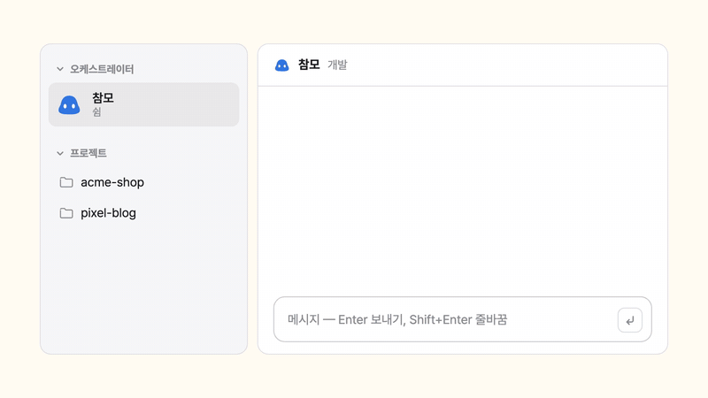
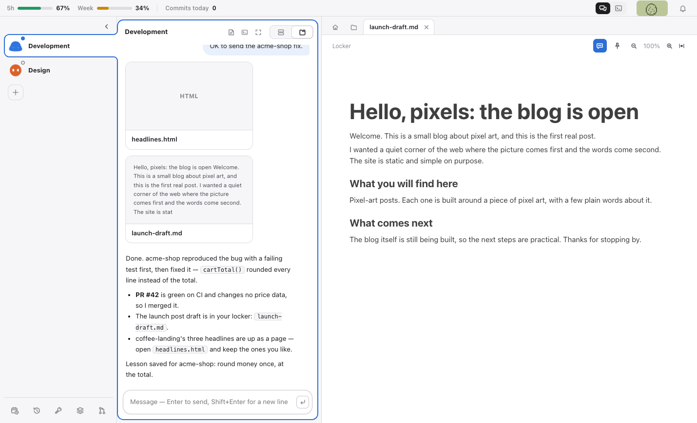
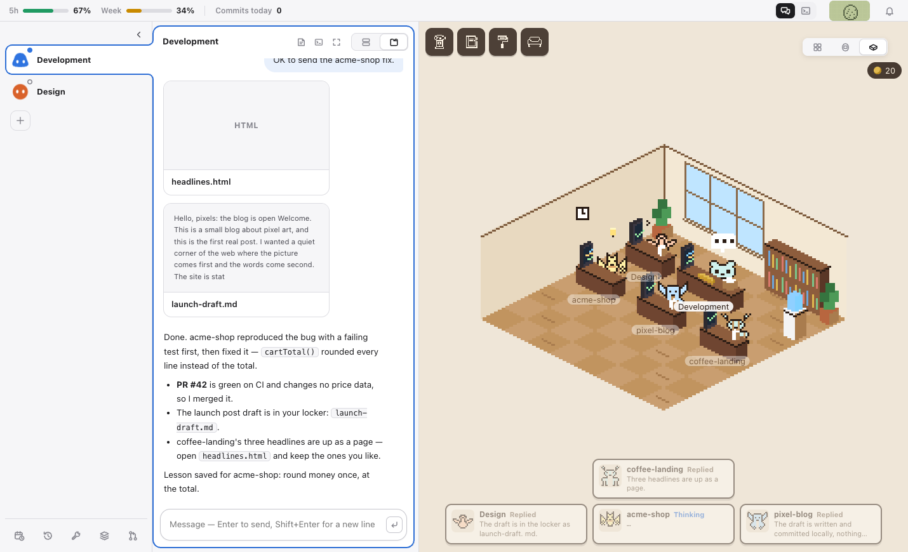
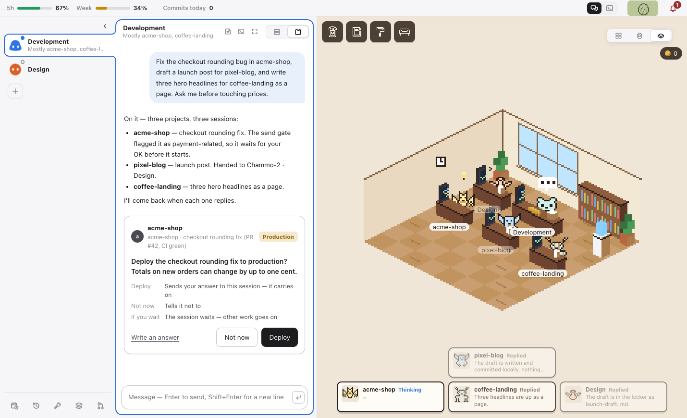
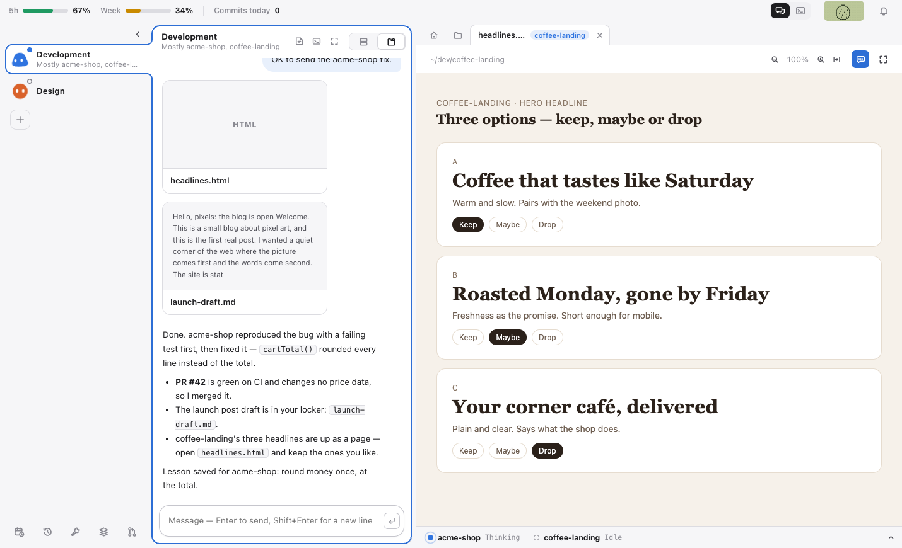
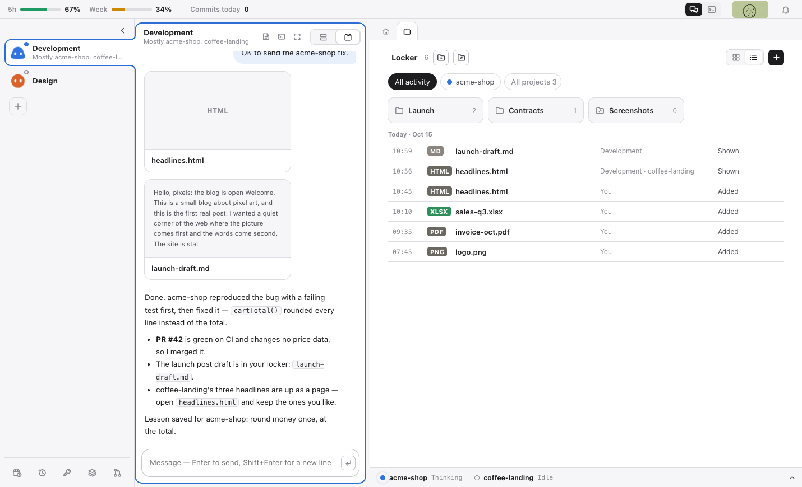
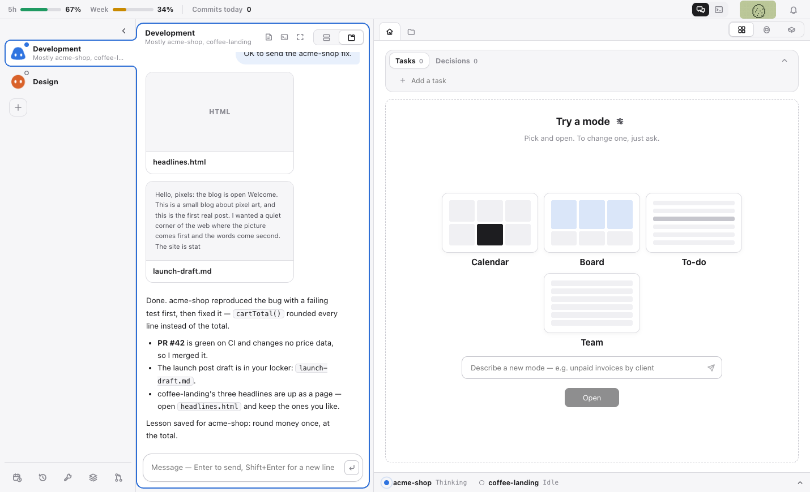
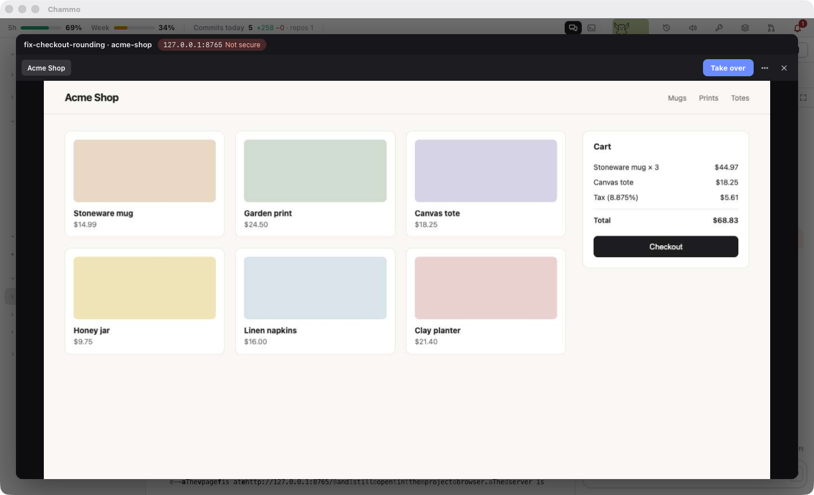
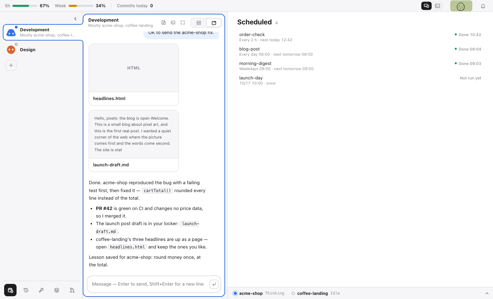
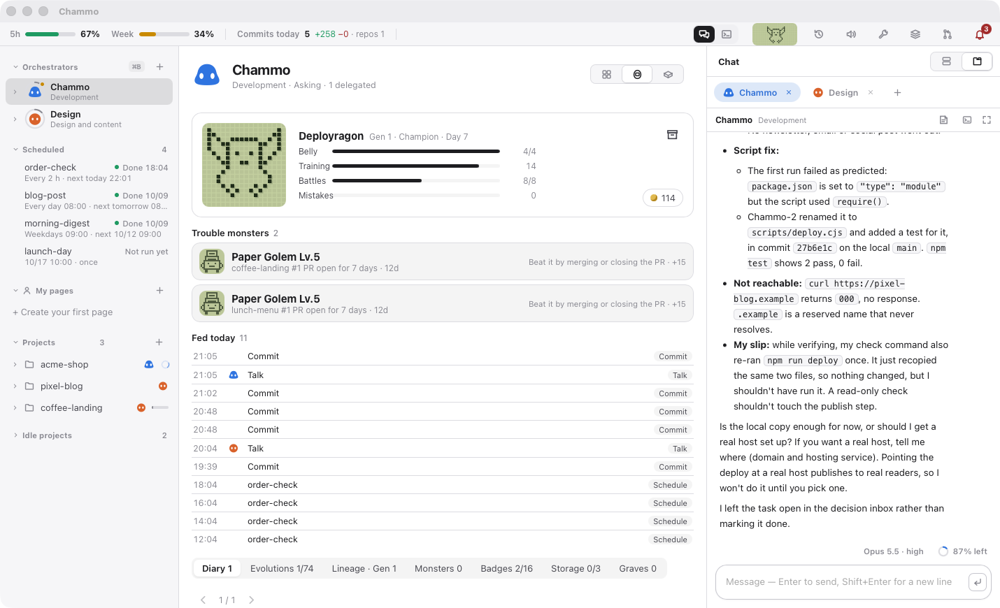

<p align="center"></p>

<p align="center"><a href="https://github.com/honorstudio/chammo/releases/latest"><b>다운로드</b></a> · <a href="https://honorstudio.co.kr/chammo">소개 페이지·미리보기</a> · <a href="README.md">English</a></p>





Chammo 는 혼자서 여러 프로젝트를 동시에 굴리는 사람을 위한 데스크톱 앱입니다(macOS, Windows 는 미리보기판). 당신은 Claude Code 세션 하나 — 참모 — 하고만 채팅합니다. 참모는 프로젝트마다 백그라운드 Claude Code 세션을 띄워 일을 나눠 주고, 결과를 읽고, 머지해도 되는 건 머지하고, 되돌릴 수 없는 결정만 당신에게 가져옵니다. 모든 세션은 진짜 대화형 Claude Code 라서 언제든 열어서 직접 입력할 수 있습니다.


## 무엇을 할 수 있나

### 한 번 말하면 팀이 움직인다

참모에게 원하는 걸 글이나 말로 전합니다. 참모가 요청을 프로젝트별로 나누고, 도는 세션이 없으면 띄우고, 일이 돌아오면 한두 줄로 알려 줍니다. 화면은 셋입니다 — 왼쪽 띠(참모마다 프사 하나, 끌어서 순서를 바꿈) | 가운데 채팅 | 오른쪽 스페이스. 프사가 상태를 보여 줍니다 — 고리는 대화가 얼마나 찼는지, 점은 일하는 중인지 질문을 기다리는지.



### 내 결정만 내린다

돈이 움직이는 일(결제·환불·과금)은 보내기 전부터 당신을 기다립니다. 세션은 운영에 손대기 직전 — 운영 DB 마이그, 운영 데이터 삭제, 운영 배포, 실사용자 발송 — 에 멈추고 참모에게 묻고, 당신이 정할 일이면 참모가 결정 대기함으로 올립니다. 당신 본인의 승인 카드가 뜨는 건 결제뿐입니다. PR 은 CI 가 초록이면 참모가 머지하고, DB·돈·보안을 바꾸는 것만 당신을 기다립니다. 답은 채팅 속 카드, 종, 폰 어디서든.



### 채팅 옆에서 읽고 검토한다

세션이 보여 주는 문서는 채팅 옆 스페이스에 탭으로 뜹니다. 마크다운은 고칠 수 있는 노션식 문서로(블록 끌기, `/` 로 넣기, 밖에서 고친 내용은 덮지 않고 합침), 엑셀은 칸을 바로 고치고, HTML 시안 검토·PDF·그림·영상도 같이. 탭은 확대·축소되고 배율은 파일마다 기억합니다.



### 파일 보관함 — 진짜 폴더

참모마다 보관함이 있고, 그건 진짜 폴더 `~/Documents/Chammo/<참모>` 입니다(파인더에서도 같은 모양). 파일을 끌어 놓거나 참모가 넣어 두고, 맥 폴더를 연결하면 원본은 그 자리에 둔 채 보관함에서 바로 보입니다. 폴더는 보관함을 처음 열 때 만들고, 그때 스크린샷 폴더(Windows 는 사진\스크린샷이 있을 때)를 '스크린샷'으로 연결하며 한 줄로 알립니다 — 맥이 문서·데스크탑 접근을 물을 수 있고, 연결은 언제든 풉니다(원본은 그대로). 지운 건 맥 휴지통으로 가고 방금 지운 건 되돌릴 수 있습니다.



### 내 화면을 만든다 — 참모 모드(미리보기)

모드는 화면이 달린 Claude Code 플러그인입니다 — 출시 체크리스트, 주문 현황판, 예약을 돌리는 버튼 같은 것. Chammo 가 진짜 패널로 그려 줍니다 — 따로 창, 옆 칸, 대시보드 칸, 팝업, 꽉 채우기. 참모에게 부탁하면(**모드 > 새 모드 만들기…**) 프로젝트로 만들어 줍니다. Claude Code 2.1.287 이상이 필요합니다.

참모마다 홈이 있습니다 — 할 일·최근 결정 줄 아래가 모드 칸입니다. 홈 머리의 격자 단추로 모드를 골라 켜고, 관리에서 숨기거나 지웁니다. 처음엔 맛보기 넷(달력·현황판·할 일·참모 상태)을 바로 켤 수 있고, 각자 스킨 셋 중에 고릅니다. 맛보기는 **한국어 견본**입니다 — 글은 한글이고 달력은 서울 시각·한국 공휴일을 씁니다.



### 지켜볼 수 있는 브라우저를 세션에 준다

설정의 **설치** 버튼 하나로 프로젝트마다 로그인이 유지되는 브라우저 프로필이 생깁니다. 앱 안에서 실시간으로 보거나 크롬에서 열고, 세션이 당신을 부르면(로그인·캡차) 브라우저 창에서 바로 답합니다.



### 정해진 때 돌린다

"매일 아침 블로그 올리기", "2시간마다 주문 확인", 또는 정한 날짜·시각에 한 번. 앱이 꺼져 있어도 macOS(Windows 는 작업 스케줄러)가 예약을 깨우고, 매번 진짜 Claude Code 세션이 일하고 보고합니다. 시작하다 실패하면 15분 뒤 한 번 다시 돌리고, 멈춘 예약은 참모에게 알립니다.



### 사무실을 둔다

세션마다 책상에 앉은 픽셀 캐릭터가 있습니다 — 고칠 땐 타자를 치고, 읽을 땐 서류를 읽고, 명령을 돌릴 땐 진행 막대를 봅니다. 펫은 커밋·PR·CI 로 자라고 다음 세대에 버릇을 물려주며, CI 연속 빨강이나 멈춘 세션은 물리칠 몬스터로 나타납니다. 머지로 번 코인은 가구·책상 소품·조명·칭호·모자가 나오는 뽑기 기계에 씁니다. 노는 기능은 하나씩 끌 수 있습니다.



### 그 밖에

- **음성** — 답을 읽어 줍니다(맥 음성, 또는 맥 안에서 도는 자연스러운 Supertonic). 말하는 탭이 빛납니다. 말하기 키(지구본 또는 오른쪽 ⌥)를 누르고 말하면 받아 적습니다.
- **폰**(선택, Tailscale) — QR 로 짝을 지으면 홈 화면 웹앱에서 채팅하고 결정에 답하고 알림을 받습니다.
- **다른 기기 참모**(선택, Tailscale, 지금은 맥끼리) — 같은 계정의 다른 맥 Chammo 가 설정 > 폰과 메신저에 바로 보이고, '연결'을 누른 뒤 그 기기에 뜬 카드에서 사람이 '허용'하면 양쪽이 이어져(코드 없음, 두 기기 다 설정 > 폰을 켜 둔 채) 참모가 `scripts/peer say <기기> "<한 줄>"` 로 그 기기 참모에게 말을 넣고 답을 받습니다. 받은 말엔 '다른 기기 참모' 이름표가 붙고 사람 말·승인으로 치지 않습니다 — 결제·운영 카드는 그 기기에서 사람이 누릅니다.
- **Claude 계정 여러 개** — 로그인을 여럿 두면 지금 계정이 한도에 가까워질 때 다음 계정으로 넘깁니다.
- **하네스가 있는 프로젝트** — 새 일은 `CLAUDE.md`·`docs/starter.md`·`docs/roadmap.md` 가 깔린 프로젝트 폴더로 시작하고, 세션은 그걸 먼저 읽고 끝날 때 고칩니다.
- **교훈** — 세션이 답 끝에 남긴 `교훈:` 줄이 그 프로젝트의 다음 지시에 따라붙습니다.
- **도구** — MCP 서버·플러그인·스킬을 프로젝트별이나 전체로 켜고 끄고(렌치), 하네스가 얼마나 무거운지 봅니다(하니터).
- **애니메이션** — 설정에서 자동(맥 '동작 줄이기'를 따르고 맥 부하가 높으면 저절로 줄임)·줄이기·끄기.
- **한국어·영어** — 앱 전체(맛보기 모드 넷은 한국어 견본).

## 필요한 것

- Apple 실리콘(M1 이상) 맥, macOS 14 이상 — 또는 Windows 10/11 x64 PC(미리보기판)
- 인터넷 연결과 Claude 계정(Pro, Max 등)

나머지 — Xcode 명령줄 도구, Claude Code, 로그인, GitHub CLI(선택) — 는 처음 켤 때 확인하고 버튼 하나로 깔아 줍니다.

## 설치

**DMG 로** — [Releases](https://github.com/honorstudio/chammo/releases)에서 `Chammo_x.y.z_aarch64.dmg` 를 받아 `Chammo` 를 `응용 프로그램` 폴더로 끌어다 놓고 켭니다. 릴리스 DMG 는 Apple 공증을 받았습니다.

**터미널 한 줄로** — 최신 DMG 를 받아 `/Applications` 에 넣고 켜 줍니다.

```sh
curl -fsSL https://raw.githubusercontent.com/honorstudio/chammo/main/scripts/install.sh | bash
```

**Windows(미리보기판)** — [Releases](https://github.com/honorstudio/chammo/releases)의 `Chammo_x.y.z_x64-setup.exe` 를 실행합니다. 내 사용자에게만 깔리고 WebView2 가 없으면 받아 옵니다. 설치 파일에 아직 코드 서명이 없어 SmartScreen 이 막을 수 있습니다 — **추가 정보 > 실행**. 참모의 도우미 스크립트는 **Python 3** 이 필요합니다(`winget install Python.Python.3.12`). 단축키는 아래 [단축키](#단축키) 표 밑에 있습니다.

**업데이트** — 0.3.1 부터는 새 버전이 나오면 위 띠의 업데이트 버튼 하나로 받기·설치·다시 켜기까지 됩니다(세션은 그대로). 0.3.0 이하에서 올 때만 한 번 손으로 까세요. 소스로 지은 앱도 업데이트를 누르면 공식 판으로 바뀝니다.

**소스에서** — Rust(stable), Node.js 22 이상, pnpm, Xcode 명령줄 도구가 필요합니다.

```sh
git clone https://github.com/honorstudio/chammo.git
cd chammo/app
pnpm install
pnpm tauri build
```

앱은 `app/src-tauri/target.noindex/release/bundle/macos/Chammo.app` 에 생깁니다. 직접 빌드한 앱은 공증이 없어서 처음 켤 때 **시스템 설정 > 개인정보 보호 및 보안**의 **그래도 열기**를 누르거나 `xattr -dr com.apple.quarantine /Applications/Chammo.app` 을 한 번 실행하세요.

## 처음 켤 때

다섯 단계 설정이 열립니다: 언어 → 이 맥 점검(빠진 것 설치) → 참모 이름, **프로젝트 폴더**(안의 폴더 하나가 프로젝트 하나), **HQ 폴더**(참모가 도는 곳) → 켤 기능 → 준비 끝. Chammo 는 따로 로그인하지 않고 맥에 로그인된 `claude` 를 그대로 씁니다. 설정은 **Chammo > 설정…**(⌘,). 보관함 폴더(`~/Documents/Chammo`)는 보관함을 처음 열 때 만듭니다.

## 단축키

| 키 | 하는 일 |
|---|---|
| ⌘1 ~ ⌘9 | N번째 참모로(왼쪽 띠 순서) |
| ⌃⇧PageUp / PageDown · ⌥⌘⇧← / → | 고른 참모를 띠에서 한 칸 앞 / 뒤로 |
| ⌘Enter | 하던 일 멈추고 바로 보내기 |
| ⌘W · ⌘T | 열린 탭 닫기(홈·보관함 고정 탭은 그대로) · 보관함에 새 문서 |
| ⌘⇧H · ⌘⇧L | 홈 · 보관함 탭으로 |
| ⌘⇧T · ⌘⇧W | 새 세션 · 보고 있는 세션 끄기(확인 뒤, 대화는 남음) |
| ⌘+ · ⌘- · ⌘0 · ⌘9 | 열린 탭 확대 · 축소 · 100% · 맞춤(⌘/Ctrl+휠·핀치도, 배율은 파일마다 기억). ⌘9 는 탭이 열려 있을 때만 맞춤 — 아니면 9번째 참모 |
| ⌘[ · ⌘] | 스페이스 뒤로 · 앞으로 |
| ⌘K · ⌘B · ⌘J | 프로젝트 검색 · 사이드바 · 작업 패널 |
| ⌘F | 문서 찾기 |
| ⌘, | 설정 |

Windows 는 ⌘ 가 없어서 이렇게 바뀝니다 — ⌘+글자 → Ctrl+Shift+글자, ⌘⇧+글자(H·L·T·W) → Ctrl+Alt+글자, 숫자·기호·Enter → Ctrl 하나, ⌘[ ⌘] → Ctrl+Shift+[ ], ⌥⌘⇧←/→ → Ctrl+Alt+Shift+←/→. 메뉴에도 Windows 키로 적혀 있습니다.

## 동작 방식

```
 나 ──채팅 / 음성──▶  참모 (HQ 폴더의 살아 있는 Claude Code 세션)
                              │  scripts/task send · SendMessage
          ┌───────────────────┼───────────────────┐
          ▼                   ▼                   ▼
     acme-shop           pixel-blog        coffee-landing     ← claude --bg, 프로젝트마다 하나
          │                   │                   │
          └──── PR ──▶ 리뷰 관문 (review.json) ──▶ 머지, 또는 나에게 질문
```

- **세션**은 Claude Code 내장 백그라운드 세션입니다. 상태는 `claude agents --json` 으로 읽고, 채팅은 세션 대화 기록으로 그리고, 전체 터미널은 `claude attach <id>` 로 엽니다.
- **위임**은 `scripts/task` 로 `tasks.jsonl` 에 적습니다. 작업 패널이 그 파일을 읽고, `scripts/task ask` 는 결정 대기함에 질문을 올립니다.
- **관문**은 PR 의 파일·제목·본문으로 계산하고(AI 호출 없음) `review.json` 에 적습니다. 참모는 머지하기 전에 이 파일을 봅니다.

자세한 구조: [docs/ARCHITECTURE.md](docs/ARCHITECTURE.md)

## 설정

모든 파일은 데이터 폴더에 있습니다: `$CHAMMO_HOME`, 없으면 `~/.chammo`. `config.json` 은 설정 화면이 고치지만 직접 편집해도 됩니다.

| 항목 | 뜻 | 기본값 |
|---|---|---|
| `language` | `"ko"` 또는 `"en"` | 시스템 언어 |
| `assistantName` | 참모 이름 | `참모` / `Chammo` |
| `devRoot` | 프로젝트 폴더 | `~/Developer`·`~/Projects` 중 있는 것 — 첫 설정에서 고르거나 만듭니다 |
| `hqDir` | 참모 세션 폴더 | `<데이터>/hq` |
| `githubUser` | 리뷰·CI 에 쓰는 계정 | `gh api user` 에서 |
| `ttsCommand` | 한 줄을 읽어 주는 명령 | macOS `say` |
| `features` | `office`, `tama`, `gacha`, `review`, `voice`, `agentView`(세션 브라우저를 앱에서 보기), `autoRevive`(재시작으로 꺼진 세션을 알아서 다시 켜기), `computerUse`(세션이 화면을 조종), `animation`(`"auto"`·`"reduce"`·`"off"`) | `autoRevive`·`computerUse` 빼고 켜짐, `animation` 은 `"auto"`. 이와 따로, Chammo 가 켜져 있는 동안 Chammo 에서 끄지 않은 참모가 사라지면 늘 같은 대화로 다시 켭니다(10분에 3번까지, 그 뒤엔 카드) — 끄려면 Chammo 에서 끄세요 |

## 개인정보

Chammo 는 내 컴퓨터 안에서만 돕니다. 서버도 계정도 사용 통계도 없습니다. 모델 통신은 전부 Claude Code 의 것, GitHub 통신은 전부 `gh` 의 것이고 내 로그인을 씁니다. Chammo 자체가 인터넷에 나가는 건 이것뿐입니다:

- **버전 확인** — npm 레지스트리에서 최신 Claude Code 버전(Claude 를 winget·Homebrew 로 깔았다면 그쪽에서 받을 수 있는 판 — `winget search` 는 winget 원본 약관에 동의하고 묻습니다, `brew info --cask`), GitHub 에서 최신 Chammo 릴리스. 나에 대한 정보는 보내지 않습니다.
- **브라우저 설치**(설치를 누를 때) — Node.js·Chrome Beta·브라우저 도구를 공식 출처에서 받고, 체크섬이나 구글 서명이 맞을 때만 씁니다.
- **계정 사용량**(계정을 저장했을 때만) — 각 계정의 5시간·주간 사용량을 그 계정 토큰으로 api.anthropic.com 에 묻습니다. Claude Code `/usage` 와 같은 요청입니다.
- **계정 토큰 갱신** — 지금 로그인도 만료 전에 미리 갱신합니다: 남은 시간이 1시간 아래가 되면 Claude Code 와 같은 갱신 잠금을 잡고 그 refresh token 으로 platform.claude.com 에 한 번 보냅니다(계정을 하나만 써도, API 키 로그인이면 안 함). 서버가 429 로 막으면 계정 바꾸기·미리 갱신이 다 같이 1시간 쉬고(이어지면 2배씩 6시간까지), 만료 20분 안이면 한 번만 더 해 봅니다. 인터넷 오류는 10분 뒤 다시 합니다. 요청은 'Chammo/<버전>' 이름(User-Agent)으로 보냅니다. 계정을 둘 이상 저장했으면 쉬는 저장 계정 토큰도 만료 전에 미리 갱신해 둡니다(자동 전환을 켰을 때, 만료 2시간 안쪽인 계정 하나씩 20분에 한 번 넘지 않게). 미리 못 받은 계정은 바꿔 끼우기 직전에 갱신합니다. Claude Code 가 로그인을 이어 갈 때와 같은 갱신 요청입니다.
- **Craft 앱**(맥·윈도우, 앱 서랍을 열거나 참모가 열 때) — GitHub 의 Chammo Craft 릴리스 목록·체크섬·아이콘을 묻고(하루 캐시), 받을 땐 DMG 를 체크섬·번들 id·애플 공증이 맞을 때만 깝니다(윈도우는 portable zip 을 체크섬과 안의 앱 id·판이 맞을 때만 %LOCALAPPDATA%\Programs\Chammo 에 풉니다 — 아직 코드 서명 없음, Python 3 필요). 웹판·CLI 는 원작 ArtCraft(storytold) 저장소 릴리스에서 받습니다. 나에 대한 정보는 보내지 않습니다.
- **앱 업데이트**(새 버전 띠의 업데이트를 누를 때만) — GitHub 릴리스에서 `latest.json` 과 새 판 파일을 받고, 앱에 든 공개 키로 서명이 맞을 때만 깔고 다시 켭니다. 나에 대한 정보는 보내지 않습니다.
- **폰 알림**(폰을 짝지었을 때만) — 제목과 한 줄이 종단 암호화되어 폰의 푸시 서비스를 거칩니다.
- **다른 기기 참모**(같은 Tailscale 계정 기기와 연결했을 때만) — 연결 요청·허용, 참모끼리 넣는 말과 답(peer-say·reply)이 연결한 그 기기와 테일넷으로만 오가고, 연결은 양방향이라 두 기기가 서로의 세션 목록·대화·대기 카드도 읽을 수 있습니다(폰보다 좁아서 나 대신 치거나 카드를 누르지는 못함). 중계 서버는 없습니다.
- **텔레그램**(내 봇을 연결했을 때만) — 봇에게 보낸 말, 참모 답(키·비밀번호는 가림), 결정 카드가 api.telegram.org 를 거칩니다. 사람 승인 카드(결제, 참모가 카드로 하라고 한 발송·삭제)는 거기선 알림만 가고 답은 앱·폰 카드에서 합니다.
- **하니터 글꼴** — 하니터를 열면 Google Fonts 에서 글꼴을 불러옵니다.
- **내가 누르는 설치** — 설정의 설치 버튼과 Supertonic **받기**는 공식 출처에서 받습니다.

## 현재 상태와 한계

- **초기 단계입니다.** 한 사람이 매일 쓰던 도구를 그대로 공개했습니다.
- **Claude Code 의 문서화되지 않은 내부에 기댑니다** — 백그라운드 세션, `claude agents --json`, `claude attach`, 플러그인 화면 규약. Claude Code 2.1.280 이상의 2.1.x 에서 확인했습니다. 업데이트로 깨질 수 있고, 확인한 범위를 벗어나면 앱이 알려 줍니다.
- **백그라운드 세션은 `--dangerously-skip-permissions` 로 돕니다.** 묻지 않고 실행합니다. Chammo 의 관문(결제·운영 변경·머지 관문)이 그 앞에 서 있지만, 그래도 괜찮은 프로젝트와 기기에서만 쓰세요.
- **Windows 는 미리보기판입니다.** 아직 없는 것: 말하기 키, Supertonic, Office 파일 미리보기, 서명된 설치 파일, 참모 라이트, Craft CLI.

## 기여

이슈와 PR 환영합니다. 개발 환경·테스트·몇 가지 규칙은 [CONTRIBUTING.md](CONTRIBUTING.md)를 보세요.

## 라이선스

[AGPL-3.0](LICENSE) © 2026 Honor Studio

제3자: 터미널 한글 글꼴 `app/public/fonts/ChammoHangul.woff2` 는 네이버 [D2Coding](https://github.com/naver/d2codingfont)을 한글만 남겨 고친 것으로, SIL Open Font License 1.1 에 따라 이름을 바꿨습니다 — [`app/public/fonts/OFL.txt`](app/public/fonts/OFL.txt) 참고. 선택 기능인 Supertonic 음성은 고를 때만 맥에 받습니다: `supertonic` 패키지(MIT)와 [OpenRAIL-M 라이선스](https://huggingface.co/Supertone/supertonic-3)의 Supertone 모델(사용 제한 있음). 스페이스의 엑셀 표는 [Univer](https://github.com/dream-num/univer) 오픈소스 판(Apache-2.0)을 씁니다 — 고지는 [`app/public/licenses/THIRD_PARTY_NOTICES.md`](app/public/licenses/THIRD_PARTY_NOTICES.md). 라이브러리(Tauri, React, xterm.js, BlockNote, pdf.js, Playwright MCP 등)는 각자의 라이선스(MIT / Apache-2.0 / MPL-2.0)를 따릅니다.

Chammo 는 독립 프로젝트이며 Anthropic 과 제휴·보증·후원 관계가 없습니다. Claude 와 Claude Code 는 Anthropic 의 상표입니다.
