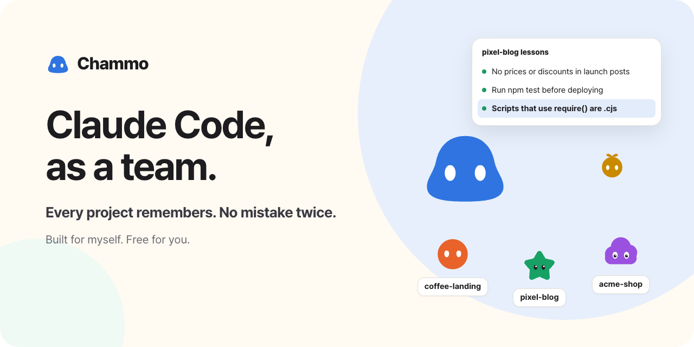
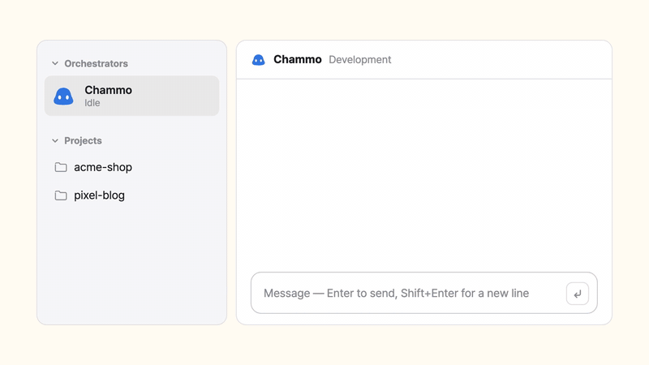

<p align="center"></p>

<p align="center"><a href="https://github.com/honorstudio/chammo/releases/latest"><b>Download</b></a> · <a href="https://honorstudio.co.kr/chammo/en">Website &amp; preview</a> · <a href="README.ko.md">한국어</a></p>




Chammo (Korean *참모*, "chief of staff", said *CHAM-oh*) is a desktop app for macOS (Windows in preview) for one person running many projects at once. You chat with one Claude Code session — your chief of staff. It starts a background Claude Code session for each project, hands out the work, reads the results, merges what is safe, and comes back to you only for the calls that can't be undone. Every session is a real interactive Claude Code session you can open and type into at any moment.


## What you can do

### Ask once, and the team gets to work

Tell the chief of staff what you want, by typing or by voice. It splits the request across projects, starts a session where none is running, and answers in a line or two when the work comes back. The window has three parts — the strip on the left (one avatar per assistant; drag to reorder) | the chat in the middle | the space on the right. An avatar carries its state: the ring is how full its context is, the dot says whether it is working or waiting on a question.


### Decide only what is yours

Anything that moves money (payments, refunds, billing) waits for you before it is even sent. Sessions stop right before they touch production — a migration on the production database, deleting production data, a production deploy, a send to real users — and ask the chief of staff, which brings it to your decision inbox when it is yours to decide. The only card that needs your own approval is a payment. Pull requests are merged by the chief of staff once CI is green; the ones that change the database, money or security wait for you. Answer from the card in the chat, the bell, or your phone.


### Read and review next to the chat

Documents a session shows you open as tabs in the space beside the chat: Markdown as Notion-like pages you can edit (drag blocks, `/` to insert; edits made outside the app are merged, not overwritten), Excel sheets you can edit cell by cell, plus HTML design reviews, PDF, images and video. Tabs zoom, and the zoom is remembered per file.


### A file locker that is a real folder

Each assistant has a locker, and it is a real folder: `~/Documents/Chammo/<assistant>` (Finder shows the same thing). Drop files in or let the assistant add them; link a Mac folder and its files show up in the locker while the originals stay where they are. The folder is created the first time you open the locker, and that is also when your screenshots folder (on Windows, Pictures\Screenshots if it exists) is linked as 'Screenshots', with a one-line note — macOS may ask for access to Documents and Desktop, and you can unlink at any time (the originals stay). Deleted items go to the macOS Trash, and the last delete can be undone.


### Make your own panels — Chammo modes (preview)

A mode is a Claude Code plugin with an interface: a launch checklist, an order board, a button that runs a routine. Chammo draws it as a real panel — in its own window, on the side, in a dashboard slot, as a pop-up, or full screen. Ask the chief of staff for one (**Modes > New Mode…**) and it builds it as a project. Needs Claude Code 2.1.287 or later.

Each assistant has a home: under the to-do and recent-decision strip is the modes area. The grid button at the top of the home picks which modes to turn on; Manage hides or removes them. Four samples are ready from the start — calendar, status board, to-do and team status — each with three skins. The samples are **Korean examples**: their text is in Korean, and the calendar uses Seoul time and Korean public holidays.


### Let sessions use a browser you can watch

One **Install** button in Settings gives each project its own browser profile that stays logged in. You watch it live inside the app or open it in Chrome, and when a session calls for you (a login, a captcha) you answer it right from the browser window.


### Run things on a schedule

"Post to the blog every morning", "check orders every 2 hours", or once at a date and time. macOS (Task Scheduler on Windows) wakes the routine even when the app is closed; each run is a real Claude Code session that reports back. If a run fails to start it is retried once 15 minutes later, and a run that stalls is reported to the chief of staff.


### Keep an office

Each session is a pixel character at a desk — typing when it edits, reading when it reads, watching a progress bar when it runs commands. A pet grows from your commits, PRs and CI runs (and passes its traits on to the next generation); a red CI streak or a stuck session shows up as a monster to beat. Coins from merges feed a capsule machine of skins, furniture, desk toys, lights, window views, titles, hats and friends. The collection is for looking; equipping and removing happen in one place, Decorate. Some sets are limited-time (the Halloween set drops until Nov 15, 23:59, and what you pulled stays after). Every playful part can be turned off.


### And also

- **Voice** — replies are spoken (a macOS voice, or Supertonic, a natural on-device voice); the tab that is speaking lights up. Hold the talk key (Globe or right ⌥) to dictate.
- **Phone** (optional, Tailscale) — pair with a QR code and chat, answer decisions and get notifications from a home-screen web app.
- **Chammo on other devices** (optional, Tailscale, Mac and Windows 0.3.8 or later) — Chammo on your other devices of the same account shows up in Settings > Phone & messenger; press Connect, have the person there press Allow on the card that pops up (no code; keep Settings > Phone on on both), and the chief of staff can put a line in front of that device's assistant with `scripts/peer say <device> "<one line>"` and get its reply. Received messages carry an "Assistant on another device" label and never count as the user's words or approval. The person can also step in directly (0.3.10 or later): in Settings > Phone & messenger > Chammo on other devices, press the chat button next to an assistant there and the chat column turns into "Remote · <device>" to talk with it, and that device's approval cards (payments too) show in this device's decision inbox and on the phone to press. Only what the person types or presses in the app's own window goes that way — messages between assistants (`scripts/peer`) can never pass as the person's words or card answers.
- **Several Claude accounts** — keep more than one login; Chammo switches to the next one when the current one nears its limit.
- **Projects with a harness** — new work gets its own project folder with `CLAUDE.md`, `docs/starter.md` and `docs/roadmap.md` that each session reads first and updates when it finishes.
- **Lessons** — sessions end replies with `Lesson:` lines; they ride along with the next instructions to that project.
- **Tools** — turn MCP servers, plugins and skills on per project or everywhere (the wrench), and see what your harness weighs (Harnitor).
- **Animation** — Auto (follows macOS Reduce Motion and calms down on its own when the Mac is busy), Reduce or Off, in Settings.
- **Korean and English** — the whole app (the four sample modes are Korean examples).

## Requirements

- A Mac with Apple silicon (M1 or later), macOS 14 or later — or a Windows 10/11 x64 PC (preview)
- An internet connection and a Claude account (Pro, Max, …)

Everything else — Xcode Command Line Tools, Claude Code, signing in, GitHub CLI (optional) — is checked on first launch and installed with one button.

## Install

**DMG** — download `Chammo_x.y.z_aarch64.dmg` from [Releases](https://github.com/honorstudio/chammo/releases), drag `Chammo` into `Applications`, and open it. Release DMGs are notarized by Apple.

**One line in Terminal** — downloads the latest DMG, puts the app in `/Applications` and opens it.

```sh
curl -fsSL https://raw.githubusercontent.com/honorstudio/chammo/main/scripts/install.sh | bash
```

**Windows (preview)** — run `Chammo_x.y.z_x64-setup.exe` from [Releases](https://github.com/honorstudio/chammo/releases). It installs for your user only and fetches WebView2 if needed. The installer is not code-signed yet, so SmartScreen may warn — click **More info > Run anyway**. The chief of staff's helper scripts and the Craft apps need **Python 3** — if it's missing, **Install** in the first-run "Check this PC" step (and in the app drawer) installs it with winget (`winget install -e --id Python.Python.3.12 --scope user --custom "InstallLauncherAllUsers=0" --accept-source-agreements --accept-package-agreements` — it accepts the winget source and package agreements for you, installs to `%LOCALAPPDATA%\Programs\Python` and puts it first on your user PATH; no admin rights needed). Since 0.3.9 Windows first-run setup needs Python 3 to continue. See the note under [Shortcuts](#shortcuts) for the Windows keys.

**Updates** — from 0.3.1 on, when a new version is out, one Update button in the top banner downloads, installs and restarts Chammo (your sessions keep running). Coming from 0.3.0 or earlier, install by hand once. An app you built from source also turns into the official build when you press Update.

**From source** — needs Rust (stable), Node.js 22+, pnpm and Xcode Command Line Tools.

```sh
git clone https://github.com/honorstudio/chammo.git
cd chammo/app
pnpm install
pnpm tauri build
```

The app lands in `app/src-tauri/target.noindex/release/bundle/macos/Chammo.app`. Your own build isn't notarized: on first launch click **Open Anyway** in **System Settings > Privacy & Security**, or run `xattr -dr com.apple.quarantine /Applications/Chammo.app` once.

## First run

A five-step setup opens: language → check this Mac (installs what is missing) → your assistant's name, the **projects folder** (each folder inside is a project) and the **HQ folder** (where the chief of staff runs) → features to turn on → ready. Chammo does not log in to anything; it uses the `claude` login already on your Mac. Settings live under **Chammo > Settings…** (⌘,). The locker folder (`~/Documents/Chammo`) is created the first time you open the locker.

## Shortcuts

| Keys | What |
|---|---|
| ⌘1 – ⌘9 | Go to the Nth assistant (in strip order) |
| ⌃⇧PageUp / PageDown · ⌥⌘⇧← / → | Move the selected assistant one place up / down the strip |
| ⌘Enter | Interrupt and send now |
| ⌘W · ⌘T | Close the open tab (pinned Home/Locker tabs stay) · new document in the locker |
| ⌘⇧H · ⌘⇧L | Go to the Home · Locker tab |
| ⌘⇧T · ⌘⇧W | New session · stop the focused session (after a confirm; the conversation is kept) |
| ⌘+ · ⌘- · ⌘0 · ⌘9 | Open tab: zoom in · out · 100% · fit (also ⌘/Ctrl+wheel and pinch; the zoom is remembered per file). With the chat input or a terminal focused, they change that text size instead. ⌘9 fits only while a tab is open — otherwise it goes to the 9th assistant |
| ⌘[ · ⌘] | Back · forward in the space |
| ⌘K · ⌘B · ⌘J | Project search · sidebar · task panel |
| ⌘F | Find in document |
| ⌘, | Settings |

Windows has no ⌘, so the keys change like this: ⌘+letter → Ctrl+Shift+letter, ⌘⇧+letter (H, L, T, W) → Ctrl+Alt+letter, digits, symbols and Enter → plain Ctrl, ⌘[ ⌘] → Ctrl+Shift+[ ], ⌥⌘⇧←/→ → Ctrl+Alt+Shift+←/→. The menus show the Windows keys too.

## How it works

```
 you ──chat / voice──▶  Chief of staff (live Claude Code session in the HQ folder)
                              │  scripts/task send · SendMessage
          ┌───────────────────┼───────────────────┐
          ▼                   ▼                   ▼
     acme-shop           pixel-blog        coffee-landing     ← claude --bg, one per project
          │                   │                   │
          └──── PRs ──▶ review gates (review.json) ──▶ merge, or ask you
```

- **Sessions** are Claude Code's built-in background sessions. Chammo reads their state from `claude agents --json`, shows the chat from each session's transcript, and opens the full terminal with `claude attach <id>`.
- **Delegation** is logged with `scripts/task` to `tasks.jsonl`; the task panel reads it, and `scripts/task ask` puts a question in your decision inbox.
- **Gates** are computed from PR files, titles and bodies (no AI calls) and written to `review.json`, which the chief of staff reads before merging.

More detail: [docs/ARCHITECTURE.md](docs/ARCHITECTURE.md).

## Configuration

Everything lives in the data folder: `$CHAMMO_HOME`, or `~/.chammo` by default. `config.json` is edited by the settings screen, but you can change it by hand:

| Field | Meaning | Default |
|---|---|---|
| `language` | `"ko"` or `"en"` | system language |
| `assistantName` | name of your chief of staff | `Chammo` / `참모` |
| `devRoot` | projects folder | `~/Developer` or `~/Projects` (whichever exists); the setup lets you pick or create one |
| `hqDir` | chief of staff's folder | `<data>/hq` |
| `githubUser` | used for review and CI | from `gh api user` |
| `ttsCommand` | command that speaks a line of text | macOS `say` |
| `features` | `office`, `tama`, `gacha`, `review`, `voice`, `agentView` (watch session browsers in the app), `autoRevive` (start sessions stopped by a restart again on their own), `computerUse` (let sessions control the screen), `animation` (`"auto"`, `"reduce"` or `"off"`) | on, except `autoRevive` and `computerUse`; `animation` is `"auto"`. Separately, while Chammo is running an assistant that disappears without being stopped in Chammo is always started again in the same conversation (up to 3 times in 10 minutes, then a card) — to stop one, stop it in Chammo |

## Privacy

Chammo runs entirely on your computer. It has no server, no account and no telemetry. All model traffic is Claude Code's and all GitHub traffic is `gh`'s, with your own logins. Chammo itself reaches the internet only for:

- **Version check** — the latest Claude Code version from the npm registry (or, if you installed Claude with winget or Homebrew, the version that installer can give you — `winget search` accepts the winget source agreements; `brew info --cask`) and the latest Chammo release from GitHub. Nothing about you is sent.
- **Browser install** (when you press Install) — Node.js, Chrome Beta and the browser tool parts from their official sources, used only after the checksum or Google signature checks out.
- **Account usage** (only if you saved accounts) — each account's 5-hour and weekly usage from api.anthropic.com with that account's own token, the same request as Claude Code's `/usage`.
- **Account token refresh** — the current sign-in is also renewed before it expires: when less than an hour is left, Chammo takes the same refresh lock Claude Code uses and sends its refresh token to platform.claude.com once (also with a single account; not for API-key sign-ins). If the server refuses with 429, account switching and both kinds of early renewal pause together for an hour (doubling up to 6 hours while it continues), with one last try when less than 20 minutes are left; network errors are retried after 10 minutes. Requests are sent with the User-Agent 'Chammo/<version>'. If you saved two or more accounts, tokens of saved accounts that are not in use are refreshed ahead of expiry too (when automatic switching is on: one account within two hours of expiry at a time, no more than once every 20 minutes). An account that could not be refreshed ahead is refreshed right before switching to it. It is the same request Claude Code makes to keep you logged in.
- **Craft apps** (macOS and Windows, when you open the app drawer or the chief of staff opens one) — asks GitHub for the Chammo Craft release list, checksums and icons (cached for 6 hours); when you download one, the DMG is installed only if its checksum, bundle id and Apple notarization check out (on Windows the portable zip is unpacked to %LOCALAPPDATA%\Programs\Chammo only if its checksum and the app id and version inside match — not code-signed yet; Python 3 needed). A Craft app Chammo installed is replaced with a newer release when you open it, without asking, after the same checks (it opens as is if the app is running, the check fails or you are offline). The web build and CLI come from the original ArtCraft (storytold) releases. Nothing about you is sent.
- **App update** (only when you press Update in the new-version banner) — downloads `latest.json` and the new version from GitHub Releases, installs it only if its signature matches the public key built into the app, and restarts. Nothing about you is sent.
- **Phone notifications** (only if you paired a phone) — a title and one line, end-to-end encrypted, through your phone's push service.
- **Other devices' assistants** (only if you linked a device of the same Tailscale account) — the link request and approval, and messages between assistants and their replies (peer-say/reply), travel only between the linked devices over your tailnet. A link works both ways, so each device can also read the other's sessions, conversations and pending cards (messages between assistants cannot type as you or press cards; only what the person types or presses in the app goes to that device. On Windows the link key sits in Credential Manager, so a program running as the same user could deliberately read it and imitate that person path — if you don't want this, unlink in Settings > Phone & messenger). There is no relay server.
- **Telegram** (only if you connect your own bot) — your messages to the bot, the chief of staff's replies (keys and passwords masked) and decision cards go through api.telegram.org. Cards that need your own approval (payments, and sends or deletions the chief of staff asked to put on a card) are only notified there; you answer them on the app or phone card.
- **Harnitor fonts** — loaded from Google Fonts when you open Harnitor.
- **Installers you start** — the setup's install buttons and the Supertonic voice's **Download** fetch from their official sources.

## Status and limitations

- **Early.** Chammo started as one person's daily tool and was opened up as is.
- **It relies on undocumented Claude Code internals** — background sessions, `claude agents --json`, `claude attach`, plugin interfaces. It is tested with Claude Code 2.1.280 and later 2.1.x. An update can break it; Chammo warns when your version is outside the tested range.
- **Background sessions run with `--dangerously-skip-permissions`.** They act without asking. Chammo's gates (payments, production changes, gated merges) sit in front of that, but only use it on projects and machines where you're comfortable with that. On a fresh install Claude Code asks you to accept that mode once — Chammo shows a card before the first assistant starts and records your answer only when you press Agree.
- **Windows is a preview.** Not there yet: the talk key, Supertonic, Office file previews, a signed installer, Chammo Light and the Craft CLI.

## Contributing

Issues and pull requests are welcome. See [CONTRIBUTING.md](CONTRIBUTING.md) for setup, tests and the few house rules.

## License

[AGPL-3.0](LICENSE) © 2026 Honor Studio

Third-party: the terminal's Hangul font `app/public/fonts/ChammoHangul.woff2` is a modified (Hangul-only) version of NAVER [D2Coding](https://github.com/naver/d2codingfont), renamed as the SIL Open Font License 1.1 requires — see [`app/public/fonts/OFL.txt`](app/public/fonts/OFL.txt). The optional Supertonic voice is downloaded to your Mac only when you pick it: the `supertonic` package (MIT) and the Supertone model under the [OpenRAIL-M license](https://huggingface.co/Supertone/supertonic-3) with its use restrictions. The spreadsheet in Space uses [Univer](https://github.com/dream-num/univer) (open-source edition, Apache-2.0) — notices in [`app/public/licenses/THIRD_PARTY_NOTICES.md`](app/public/licenses/THIRD_PARTY_NOTICES.md). Libraries (Tauri, React, xterm.js, BlockNote, pdf.js, Playwright MCP, …) keep their own licenses (MIT / Apache-2.0 / MPL-2.0); see each package.

Chammo is an independent project. It is not affiliated with, endorsed by, or sponsored by Anthropic. Claude and Claude Code are trademarks of Anthropic.
