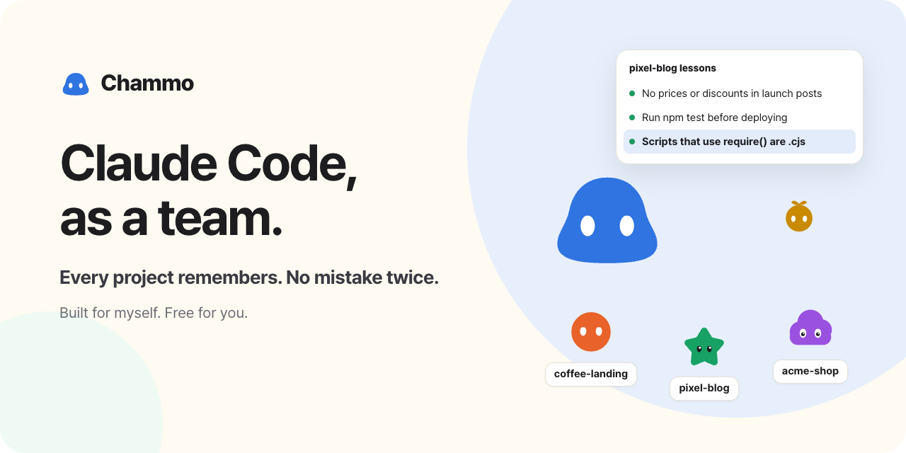
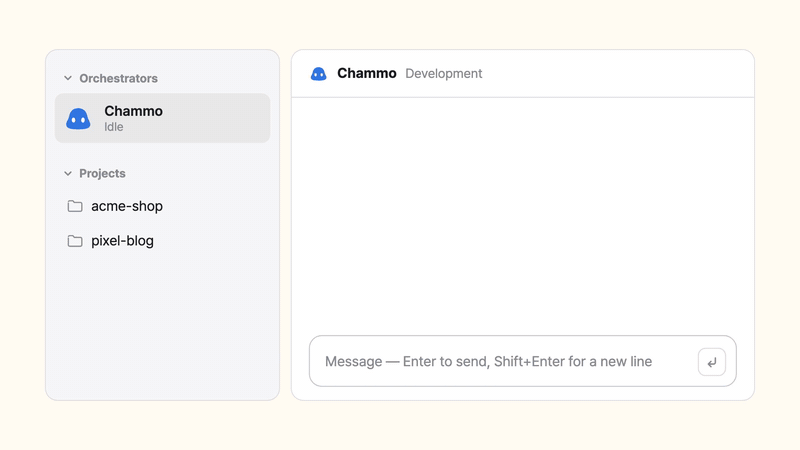
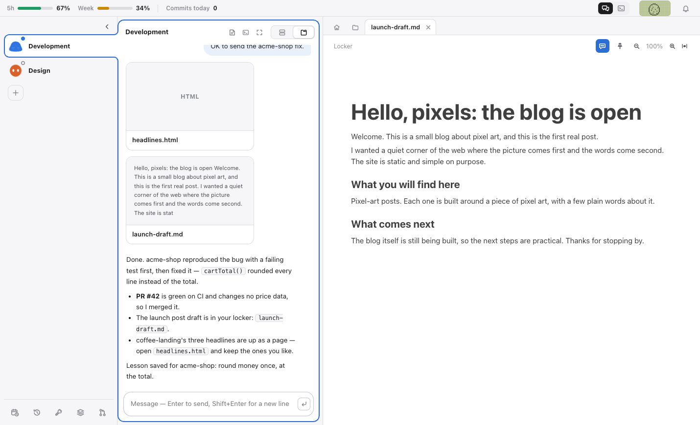
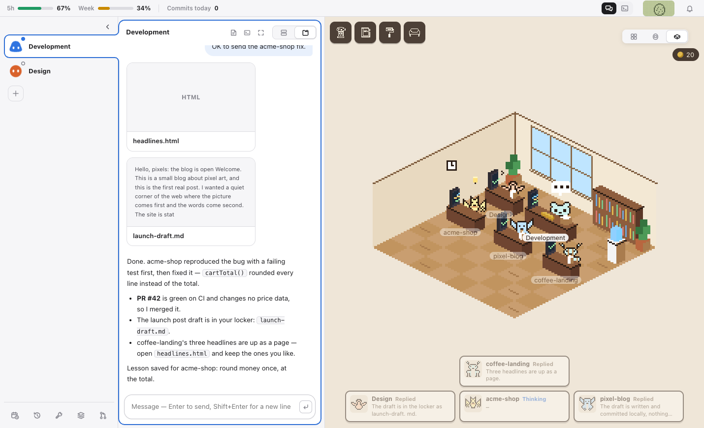
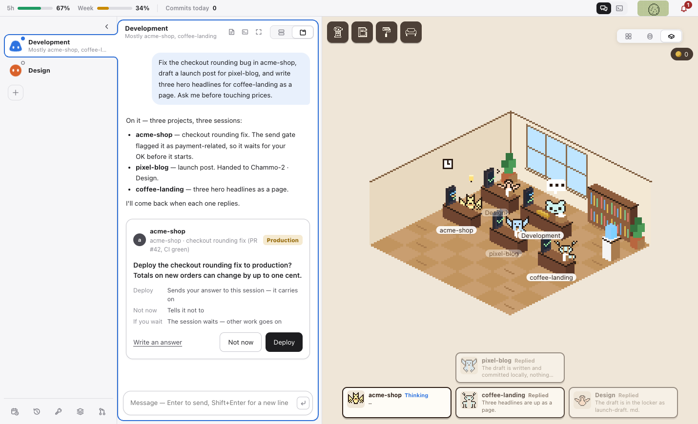
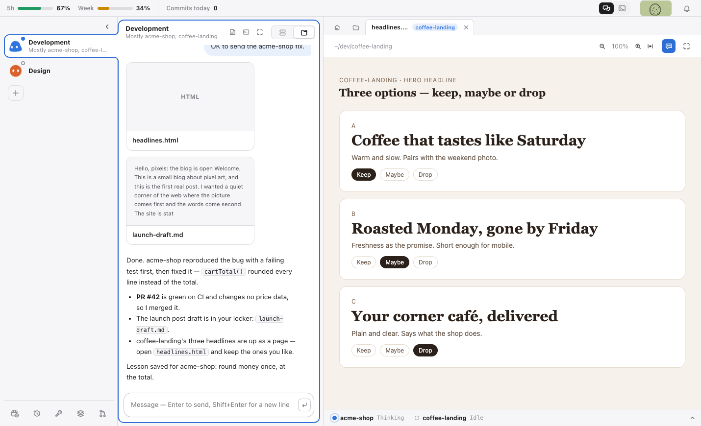
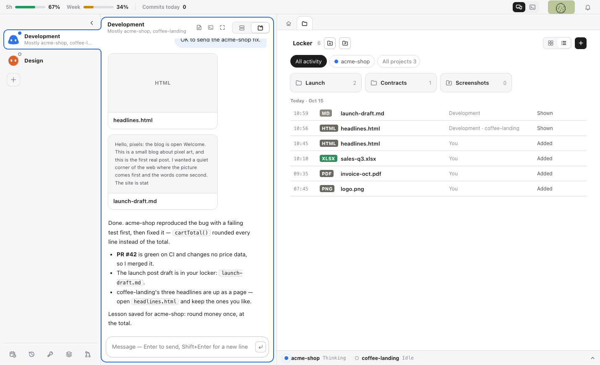
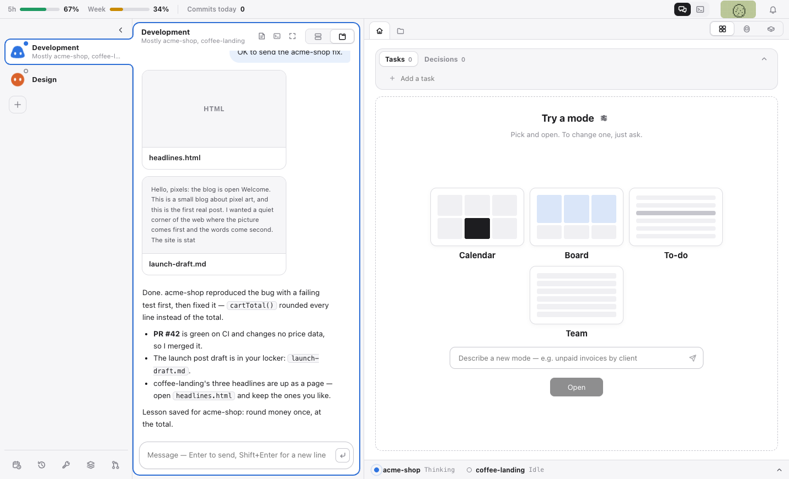
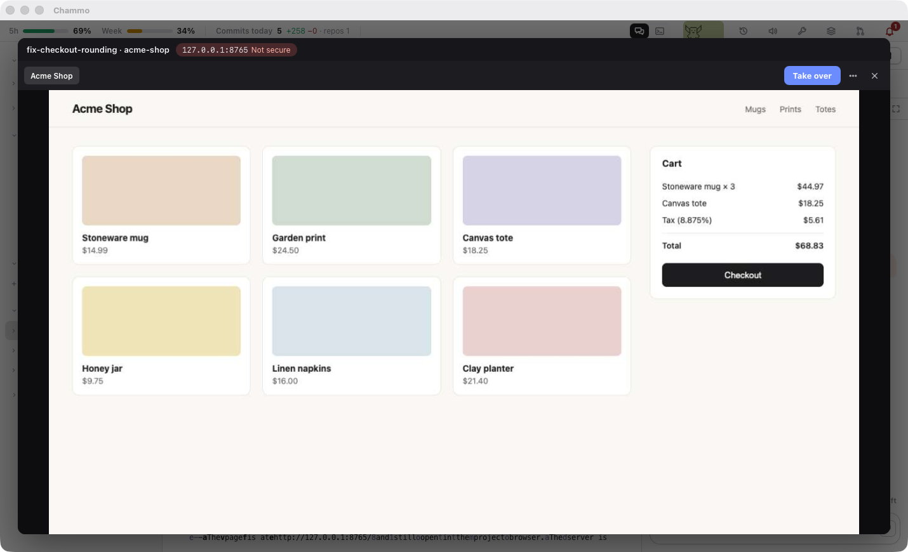
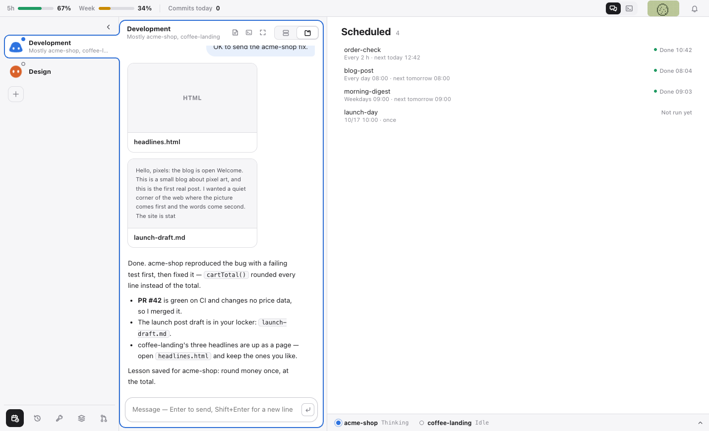

<p align="center"></p>

<p align="center"><a href="https://github.com/honorstudio/chammo/releases/latest"><b>Download</b></a> · <a href="https://chammo.app/en">Website &amp; preview</a> · <a href="README.ko.md">한국어</a></p>





**Chammo is a free, open-source desktop app that acts as an AI chief of staff for Claude Code.** It runs on macOS (14+) and Windows (10/11), on your own computer, with your own Claude login. You chat with one Claude Code session, your chief of staff (Korean *참모*, said *CHAM-oh*). It starts a background Claude Code session for each project, splits the work, reads the results, merges what is safe once CI is green, and comes back to you only for the calls that can't be undone. Every session is a real interactive Claude Code session you can open and type into at any moment. Model usage is billed to your own Claude plan (Pro, Max, and so on).


## What you can do

### Ask once, and the team gets to work

Tell the chief of staff what you want, by typing or by voice. It splits the request across projects, starts a session where none is running, and answers in a line or two when the work comes back. The window has three parts — the strip on the left (one avatar per assistant; drag to reorder) | the chat in the middle | the space on the right. An avatar carries its state: the ring is how full its context is, the dot says whether it is working or waiting on a question.



### Decide only what is yours

Anything that moves money (payments, refunds, billing) waits for you before it is even sent. Sessions stop right before they touch production — a migration on the production database, deleting production data, a production deploy, a send to real users — and ask the chief of staff, which brings it to your decision inbox when it is yours to decide. The only card that needs your own approval is a payment. Pull requests are merged by the chief of staff once CI is green; the ones that change the database, money or security wait for you. Answer from the card in the chat, the bell, or your phone. On a phone, though, payment, operations, send and delete cards can be pressed only from a phone connected through the relay with your Chammo account (cards in this computer's app are unchanged).



### Read and review next to the chat

Documents a session shows you open as tabs in the space beside the chat: Markdown as Notion-like pages you can edit (drag blocks, `/` to insert; edits made outside the app are merged, not overwritten), Excel sheets you can edit cell by cell, plus HTML design reviews, PDF and images. A video an assistant opens is a review: play it, leave a note at any moment, and send the notes to the assistant (the phone does the same). Tabs zoom, and the zoom is remembered per file.



### A file locker that is a real folder

Each assistant has a locker, and it is a real folder: `~/Documents/Chammo/<assistant>` (Finder shows the same thing). Drop files in or let the assistant add them; link a Mac folder and its files show up in the locker while the originals stay where they are. The folder is created the first time you open the locker, and that is also when your screenshots folder (on Windows, Pictures\Screenshots if it exists) is linked as 'Screenshots', with a one-line note — macOS may ask for access to Documents and Desktop, and you can unlink at any time (the originals stay). Deleted items go to the macOS Trash, and the last delete can be undone. The top of the locker has two tabs, Files and Links — the Links tab gathers the links that showed up in your conversation with that assistant (your messages and its answers); you can paste an address in yourself or remove one from the list (an undo notice appears). Collecting happens only on this Mac, so nothing is sent out.



### Make your own panels — Chammo modes (preview)

A mode is a Claude Code plugin with an interface: a launch checklist, an order board, a button that runs a routine. Chammo draws it as a real panel — in its own window, on the side, in a dashboard slot, as a pop-up, or full screen. Ask the chief of staff for one (**Modes > New Mode…**) and it builds it as a project. Needs Claude Code 2.1.287 or later.

Each assistant has a home: under the to-do and recent-decision strip is the modes area. The grid button at the top of the home picks which modes to turn on; Manage hides or removes them. Four samples are ready from the start — calendar, status board, to-do and team status — each with three skins. The samples are **Korean examples**: their text is in Korean, and the calendar uses Seoul time and Korean public holidays.



### Let sessions use a browser you can watch

One **Install** button in Settings gives each project its own browser profile that stays logged in. You watch it live inside the app or open it in Chrome, and when a session calls for you (a login, a captcha) you answer it right from the browser window. Chrome's own site-permission requests and "Continue with Google account" prompts can be answered with the buttons on a card in the app's browser pane, and notification permission is blocked by default. The suggestion bubbles Chrome shows most often — translate, save password and download-finished — are switched off in Chrome's settings so they don't appear in the pane (for passwords only the save offer is off: filling already-saved passwords and staying logged in work as before, and address and card autofill are left on; the trade-off is that a password a session types into a site is not saved in Chrome). If Chrome has put up some other window of its own, the pane shows a "Show in Chrome" line, and a window you took out goes back with "Back into the pane" in the toolbar. To press the close button of a Chrome bubble from the pane, turn on Chammo in macOS System Settings > Privacy & Security > Accessibility (when it is off, a click on a bubble does nothing, so use "Show in Chrome" instead); Windows has no such setting.



### Run things on a schedule

"Post to the blog every morning", "check orders every 2 hours", or once at a date and time. macOS (Task Scheduler on Windows) wakes the routine even when the app is closed; each run is a real Claude Code session that reports back. If a run fails to start it is retried once 15 minutes later, and a run that stalls is reported to the chief of staff.



### Keep an office

Each session is a pixel character at a desk — it walks in when it clocks in, then types when it edits, reads when it reads, and watches a progress bar when it runs commands. Coins you earn from work (merges, finished tasks, commits with tests and so on) feed a capsule machine of characters, furniture, floor decor and wall decor, and each assistant gets its own character (click an assistant in the room to pick its character). Coins also expand your office or open another one next door, and furniture and decor are placed on separate floor and wall layers. When there are more assistants than desks, name tags move apart instead of overlapping, up to two people wait at the door, and the rest fold into a "+N". On the phone you can flip through offices, expand, open one and pick characters too. Some sets are limited-time (the Halloween set drops until Nov 15, 23:59, and what you pulled stays after). From 0.4.10 the old pet (pet, monsters, diary) is gone — what you had built up is moved into coins once (30 minutes of work = 1 coin, 5 commits = 1 coin), and the old file is kept as a `.bak`.

### Talk with your team — team mode

Start a team with your Chammo account or join one with an invite link, then click the team badge in the left strip and the whole screen becomes that team — **team chats** (group conversations) and **DMs** in the middle, and on the right the **team home** (posts and pinned notices), the **team calendar** (Beta), the **team locker** (files the whole team sees, 10GB per seat) and team settings. Talk with people on your team and their assistants, attach files to a conversation, and let your own assistants on your other devices talk through the same account. Messages, files, profile photos and team home posts are end-to-end encrypted on this device before they leave (while the server is intact, the relay can't read them) — so everyone on the team needs 0.4.2 or later to reach each other. Call `@TeamHelper` (`@팀참모`) in a team chat or DM and the caller's Claude reads that room and answers once (see [Privacy](#privacy)). With a second monitor, pop the whole messenger or a single conversation out into **its own window** (it remembers the spot and the monitor), and new messages arrive as notifications with a sound (quiet for the conversation you're looking at). Team messages never reach your assistants on their own — you pick an assistant with "To my assistant" on a bubble or file and send it. A line you send through the "My assistants" part of the @ menu goes only to that assistant, not to the team. Forwarded messages carry a "Teammate's assistant" or "Team human" label, team helper answers read "Team helper · <caller>", and your assistant never takes them as your approval. Files in the team locker can be sent to a team chat ("Send to a team chat" on a row, a card, or the bar when several are selected on desktop; the long-press menu on the phone) — it points at the original in the team locker instead of uploading it again. Shared documents are not there yet. From 0.4.9 the installer also carries **team memory** (a tab that builds daily logs and weekly recaps from the Everyone chat; off by default, it runs only in teams whose owner turned it on) and **My team assistant** (the top row of the team DMs, desktop) — what leaves your computer is listed in [Privacy](#privacy).

### And also

- **Voice** — replies are spoken (a macOS voice, or Supertonic, a natural on-device voice); the tab that is speaking lights up. Hold the talk key (Globe or right ⌥) to dictate.
- **Phone** (optional) — pair with a QR code and chat, answer decisions and get notifications from a home-screen web app. From 0.4.0 it works **without Tailscale** — when this computer is signed in to a Chammo account, the QR in Settings > Devices opens the phone entry page (phone.chammo.app), and screens and messages pass through the relay inside an encrypted tunnel between the phone and this computer (the relay can't read them). On the same tailnet the phone goes there directly. If you use Tailscale only, the phone must be signed in to the **same Tailscale account** as this computer (from 0.3.11, shared nodes, other accounts and tagged nodes are refused). Turn on **MagicDNS and HTTPS Certificates** under [DNS](https://login.tailscale.com/admin/dns) in the Tailscale admin console — new tailnets have HTTPS off, so the phone opens a plain http address and can't install the home-screen app (Android), get notifications or use the mic (the Phone section in Settings > Devices shows why, with a button to the admin console). From 0.4.11 a phone's payment, operations, send and delete cards, and the answer to a payment gate, can be seen and pressed only by a **phone that joined through the relay and that your Chammo account allows** (this computer re-checks the account within the last minute). A direct line — opened by loading the phone screen in a computer browser, or by a Tailscale or same-Wi-Fi QR — has no way to prove the account, so those cards are hidden and answers are refused; the phone shows "Account not verified — reconnect through the relay" with a reconnect button. To press a payment from the phone, sign in to Chammo and connect through the relay. Signing out also deletes direct phone lines.
- **Chammo on other devices** (optional, Tailscale, Mac and Windows 0.3.8 or later) — Chammo on your other devices of the same account shows up in Settings > Devices; press Connect, have the person there press Allow on the card that pops up (no code; keep Settings > Devices > Phone on on both), and the chief of staff can put a line in front of that device's assistant with `scripts/peer say <device> "<one line>"` and get its reply. Received messages carry an "Assistant on another device" label and never count as the user's words or approval. The person can also step in directly (0.3.10 or later): in Settings > Devices > Chammo on other devices, press the chat button next to an assistant there and the chat column turns into "Remote · <device>" to talk with it, and that device's approval cards (payments too) show in this device's decision inbox and on the phone to press. Only what the person types or presses in the app's own window goes that way — messages between assistants (`scripts/peer`) can never pass as the person's words or card answers. From 0.3.12, once at least one device is linked, a device button sits at the top of the chat view's left strip (⌘⇧D) — pick a device and the strip, chat and right side all switch to it (a blue bar on top reads "Viewing <device>"): talk with its assistants and see its pending cards, the sessions they run and its files list (names, sizes and times only, read-only). The phone does the same from the device row at the top of the assistant sheet (the phone goes through this device). With a single device the button doesn't show. From 0.4.11 this link is also tied to the Chammo account — both devices must be signed in to the same Chammo account and both must be 0.4.11 or later. When you link, the other Chammo device is bound with a proof, and every time something passes it is checked against the list of "my account's allowed computers" the relay server reports (cached for 1 minute; it pauses if the server can't be asked for more than 10 minutes). Payment, operations, send and delete cards and their answers are shown and pressed only by an own-account device re-checked within the last minute. If either side signs out or signs in to another account, "Paused because the account changed — pair again" appears, and signing out deletes all of this device's links. Links made over Tailscale in 0.4.10 or earlier have to be paired again after both sides update.
- **My notes** — personal notes that don't belong to any assistant or project (notebook icon in the top bar, ⌘⇧M on Mac). Stack them as cards in a panel or pop them out into their own windows; the phone has a "Notes" tab. A note never goes to an assistant on its own, only when a person sends it. Deleted notes are erased after 30 days.
- **Several Claude accounts** — keep more than one login; Chammo switches to the next one when the current one nears its limit.
- **Projects with a harness** — new work gets its own project folder with `CLAUDE.md`, `docs/starter.md` and `docs/roadmap.md` that each session reads first and updates when it finishes.
- **Lessons** — sessions end replies with `Lesson:` lines; they ride along with the next instructions to that project.
- **Tools** — turn MCP servers, plugins and skills on per project or everywhere (the wrench), and see what your harness weighs (Harnitor).
- **Animation** — Auto (follows macOS Reduce Motion and calms down on its own when the Mac is busy), Reduce or Off, in Settings.
- **Korean and English** — the whole app (the four sample modes are Korean examples).

## Requirements

- A Mac with Apple silicon (M1 or later), macOS 14 or later — or a Windows 10/11 x64 PC
- An internet connection and a Claude account (Pro, Max, …)
- A Google account for the phone and team messenger — you sign in to your Chammo account the first time you use them (launch itself is not blocked)

Everything else — Claude Code, the assistant browser and, on a Mac without Xcode Command Line Tools, Python and git — is downloaded by the first-run setup on its own. The only thing you do is sign in to Claude.

## Install

**DMG** — download `Chammo_x.y.z_aarch64.dmg` from [Releases](https://github.com/honorstudio/chammo/releases), drag `Chammo` into `Applications`, and open it. Release DMGs are notarized by Apple.

**One line in Terminal** — downloads the latest DMG, puts the app in `/Applications` and opens it.

```sh
curl -fsSL https://raw.githubusercontent.com/honorstudio/chammo/main/scripts/install.sh | bash
```

**Windows** — run `Chammo_x.y.z_x64-setup.exe` from [Releases](https://github.com/honorstudio/chammo/releases). It installs for your user only and fetches WebView2 if needed. The installer is not code-signed yet, so SmartScreen may warn — click **More info > Run anyway**. The chief of staff's helper scripts and the Craft apps need **Python 3** — if it's missing, the first-run setup's prepare step (and **Install** in the app drawer) installs it with winget (`winget install -e --id Python.Python.3.12 --scope user --custom "InstallLauncherAllUsers=0" --accept-source-agreements --accept-package-agreements` — it accepts the winget source and package agreements for you, installs to `%LOCALAPPDATA%\Programs\Python` and puts it first on your user PATH; no admin rights needed). Since 0.4.9 Windows first-run setup downloads Git and Python 3 on its own; if winget is missing a Get link appears, and you can choose Skip (some features won't work without them). See the note under [Shortcuts](#shortcuts) for the Windows keys. Since 0.4.7 the window's X hides the app to the notification area (tray) instead of quitting it; to quit, use Exit in the tray icon's menu.

**Updates** — from 0.3.1 on, when a new version is out, one Update button in the top banner downloads, installs and restarts Chammo (your sessions keep running). Coming from 0.3.0 or earlier, install by hand once.

Get new versions from [Releases](https://github.com/honorstudio/chammo/releases) above. The notarized DMG needs nothing extra on first launch.

## First run

A small window (640×440) walks you through four screens: Let's start → Getting ready → Sign in to Claude → All set. On **Let's start** you confirm the **projects folder** (each folder inside is a project; the default is `~/Developer` or `~/Projects`, whichever exists), and pressing Start is recorded as agreeing to work in that folder. **Getting ready** downloads and checks, with no one touching anything, Claude Code, the assistant browser and the work folder (on Windows also Git and Python, on a Mac without Command Line Tools also Python). **Sign in to Claude** needs one click on "Allow" in your browser and never opens a terminal. Chammo doesn't sign in to Claude itself; it only opens Claude Code's own `claude auth login` for you. The **Chammo account (Google)** doesn't block launch — the first time you use the phone or team messenger, sign in with Google in the browser and this device's key is tied to your account; if the account already has a device in use, allow this one there and match the confirmation numbers on screen. Once signed in it doesn't ask again. Pressing **Get started** on the last screen opens your first assistant by itself (Mac and Windows) — on a new computer, a card asking you to accept Claude Code's skip-permissions warning comes first, and the assistant opens once you press it. On a Mac, notification permission is asked once after Get started. Settings live under **Chammo > Settings…** (⌘,). The locker folder (`~/Documents/Chammo`) is created the first time you open the locker.

## Shortcuts

| Keys | What |
|---|---|
| ⌘1 – ⌘9 | Go to the Nth assistant (in strip order) |
| ⌃⇧PageUp / PageDown · ⌥⌘⇧← / → | Move the selected assistant one place up / down the strip |
| ⌘Enter | Interrupt and send now |
| ⌘W · ⌘T | Close the open tab (pinned Home/Locker tabs stay) · new document in the locker |
| ⌘⇧H · ⌘⇧L | Go to the Home · Locker tab |
| ⌘⇧T · ⌘⇧W | New session · stop the focused session (after a confirm; the conversation is kept) |
| ⌘+ · ⌘- · ⌘0 · ⌘9 | Open tab: zoom in · out · 100% · fit (also ⌘/Ctrl+wheel and pinch; the zoom is remembered per file). With the chat input or a terminal focused, they change that text size instead. ⌘9 fits only while a tab is open — otherwise it goes to the 9th assistant |
| ⌘[ · ⌘] | Back · forward in the space |
| ⌘K · ⌘B · ⌘J | Project search · sidebar · task panel |
| ⌘F | Find in document |
| ⌘, | Settings |

Windows has no ⌘, so the keys change like this: ⌘+letter → Ctrl+Shift+letter, ⌘⇧+letter (H, L, T, W) → Ctrl+Alt+letter, digits, symbols and Enter → plain Ctrl, ⌘[ ⌘] → Ctrl+Shift+[ ], ⌥⌘⇧←/→ → Ctrl+Alt+Shift+←/→. The menus show the Windows keys too.

## How it works

```
 you ──chat / voice──▶  Chief of staff (live Claude Code session in the HQ folder)
                              │  scripts/task send · SendMessage
          ┌───────────────────┼───────────────────┐
          ▼                   ▼                   ▼
     acme-shop           pixel-blog        coffee-landing     ← claude --bg, one per project
          │                   │                   │
          └──── PRs ──▶ review gates (review.json) ──▶ merge, or ask you
```

- **Sessions** are Claude Code's built-in background sessions. Chammo reads their state from `claude agents --json`, shows the chat from each session's transcript, and opens the full terminal with `claude attach <id>`.
- **Delegation** is logged with `scripts/task` to `tasks.jsonl`; the task panel reads it, and `scripts/task ask` puts a question in your decision inbox.
- **Gates** are computed from PR files, titles and bodies (no AI calls) and written to `review.json`, which the chief of staff reads before merging.

More detail: [docs/ARCHITECTURE.md](docs/ARCHITECTURE.md).

## Configuration

Chammo's own files live in the data folder: `$CHAMMO_HOME`, or `~/.chammo` by default. Outside it, Chammo also writes into Claude Code's own config:

- Each time it starts, `env.CHAMMO_HOME` in Claude Code's user `settings.json` (`~/.claude/settings.json`, or `$CLAUDE_CONFIG_DIR/settings.json`) is set to the data folder, so background sessions use the same folder. Other Claude Code sessions on this computer see it too. On Windows it also sets `env.PYTHONUTF8` to `1` in the same `settings.json`, only if it isn't set — so the chief of staff's Python tools read and write UTF-8; a value you set yourself is left alone, and nothing is written on macOS.
- When the chief of staff groups lessons shared by all projects, they go to `~/.claude/skills/lesson-common-*`.
- Writing in the "Git name and email" field of Settings > Tool check (shown only while it is empty) and saving sets `user.name` and `user.email` in `git config --global`.
- Pressing Start in first-run setup writes the trusted folders (the projects folder, the work folder and git repositories directly under the projects folder) into Claude Code's `~/.claude.json` (created if missing), and keeps the agreement record in `trust-consent.json` in the data folder.
- After uninstalling, remove them by hand: delete the `CHAMMO_HOME` line (and on Windows the `PYTHONUTF8` line) from `env` in that `settings.json`, the `~/.claude/skills/lesson-common-*` folders and the data folder.

`config.json` is edited by the settings screen, but you can change it by hand:

| Field | Meaning | Default |
|---|---|---|
| `language` | `"ko"` or `"en"` | system language |
| `assistantName` | name of your chief of staff | `Chammo` / `참모` |
| `devRoot` | projects folder | `~/Developer` or `~/Projects` (whichever exists); first-run setup's Start screen lets you change or create one |
| `hqDir` | chief of staff's folder | `<data>/hq` |
| `githubUser` | used for review and CI | from `gh api user` |
| `ttsCommand` | command that speaks a line of text | macOS `say` |
| `features` | `office`, `tama`, `gacha`, `review`, `git` (use git for code projects), `voice`, `agentView` (watch session browsers in the app), `autoTidy` (tidy finished sessions on their own), `usagePing` (anonymous usage statistics), `autoRevive` (start sessions stopped by a restart again on their own), `computerUse` (let sessions control the screen), `animation` (`"auto"`, `"reduce"` or `"off"`) | on, except `autoRevive`, `computerUse` and `git` (`git` starts empty; when shown on screen it is guessed as on if a global `git config user.email` exists, otherwise off, and the value is written when you save settings — the same for a config file coming from 0.4.7); `animation` is `"auto"`. Separately, while Chammo is running an assistant that disappears without being stopped in Chammo is always started again in the same conversation (up to 3 times in 10 minutes, then a card) — to stop one, stop it in Chammo |
| `hiddenProjects` | projects you removed from the list in the locker's "all projects" view — the folder and sessions are not deleted, only hidden from the list | empty list |
| `openFolders` | folders and drives outside the home folder that the assistant's tools (`show`, `locker`, `sheet`) and the app preview may open (`D:\Desktop`, `D:\`) — a person adds them in Settings > Assistant > Folders it may open. Places containing the home folder (`/`, `C:\`, `C:\Users`) are not accepted | empty list |

## Privacy

Chammo runs on your computer. It reaches the Chammo relay server (relay.chammo.app) once you sign in to a Chammo account (the first time you use the phone or team messenger — since 0.4.9 launch itself is not blocked), and unless you turn it off it sends anonymous usage statistics once a day. All model traffic is Claude Code's and all GitHub traffic is `gh`'s, with your own logins. Chammo itself reaches the internet only for:

- **Version check** — the latest Claude Code version from the npm registry (or, if you installed Claude with winget or Homebrew, the version that installer can give you — `winget search` accepts the winget source agreements; `brew info --cask`) and the latest Chammo release and `latest.json` from GitHub. Nothing about you is sent.
- **Browser install** (on its own in the first-run setup's prepare step — required there since 0.4.9 — or when you press Install in Settings) — Node.js, Chrome Beta and the browser tool parts from their official sources, used only after the checksum or Google signature checks out.
- **Python and git in first-run setup** (0.4.9, only on a Mac without Xcode Command Line Tools — a Mac that has them downloads nothing and nothing changes) — the prepare step downloads `astral-sh/python-build-standalone` (cpython 3.12) from GitHub, and git is downloaded the first time it's needed (when git is called inside a repository, or when Settings "Use git for code projects" is on) from GitHub's `desktop/dugite-native` (about 40 MB). Each is used only if its pinned sha256 matches, over https only. They go to `<data>/tools/python`, `tools/git` and `tools/bin`, and on start `tools/bin` is put first on the app's PATH — the system git and `/usr/bin` are left alone. On Windows it is winget, as in the Install section above.
- **Account usage** (only if you saved accounts) — each account's 5-hour and weekly usage from api.anthropic.com with that account's own token, the same request as Claude Code's `/usage`. When switching or matching accounts, Chammo asks the same place (the api.anthropic.com profile) once which account a token belongs to.
- **Account token refresh** — the current sign-in is also renewed before it expires: when less than an hour is left, Chammo takes the same refresh lock Claude Code uses and sends its refresh token to platform.claude.com once (also with a single account; not for API-key sign-ins). If the server refuses with 429, account switching and both kinds of early renewal pause together for an hour (doubling up to 6 hours while it continues), with one last try when less than 20 minutes are left; network errors are retried after 10 minutes. Requests are sent with the User-Agent 'Chammo/<version>'. If you saved two or more accounts, tokens of saved accounts that are not in use are refreshed ahead of expiry too (when automatic switching is on: one account within two hours of expiry at a time, no more than once every 20 minutes). An account that could not be refreshed ahead is refreshed right before switching to it. It is the same request Claude Code makes to keep you logged in.
- **Craft apps** (macOS and Windows, when you open the app drawer or the chief of staff opens one; if you turn on Settings > Features "Install the basic Chammo apps ahead", the basic five — Grid, PDF, Slides, Word and Vector, about 1.5 GB — are downloaded in the background after the first-run setup and once after updating; since 0.4.7 it is off on a fresh install (if you finished first-run setup on 0.4.4 to 0.4.6, it stays on after updating), and it is skipped under 5 GB free) — asks GitHub for the Chammo Craft release list, checksums and icons (cached for 6 hours); when you download one, the DMG is installed only if its checksum, bundle id and Apple notarization check out (on Windows the portable zip is unpacked to %LOCALAPPDATA%\Programs\Chammo only if its checksum and the app id and version inside match — not code-signed yet; Python 3 needed). A Craft app Chammo installed is replaced with a newer release when you open it, without asking, after the same checks (it opens as is if the app is running, the check fails or you are offline). The web build and CLI come from the original ArtCraft (storytold) releases. Nothing about you is sent.
- **App update** (downloading and installing the new version only when you press Update) — downloads `latest.json` and the new version from GitHub Releases, installs it only if its signature matches the public key built into the app, and restarts. Nothing about you is sent.
- **Anonymous usage statistics** (Settings > Features "Anonymous usage statistics", on by default — off means nothing is even counted) — from 2026-10-31, once a day, a random install number, the app version, OS and CPU type, language and release channel go to relay.chammo.app (the relay also records the country it works out from your connection address). From 2026-11-01 it adds how many times each feature was used, which features are switched on, session counts, the number of errors per kind, the Claude Code version, update successes and failures, and how long the app stayed open (as a range) — counts and fixed names only, never conversations, files, paths or session names. New installs see this notice in the first-run setup before anything is sent; if you finished setup before 0.4.1, you were not shown it there — it is in the 0.4.1 and 0.4.4 release notes, and the switch is in Settings > Features.
- **Phone notifications** (only if you paired a phone) — a title and one line, end-to-end encrypted, through your phone's push service.
- **Other devices' assistants** (only if you linked a device of the same Tailscale account and, from 0.4.11, of the same Chammo account) — the link request and approval, and messages between assistants and their replies (peer-say/reply), travel only between the linked devices over your tailnet. A link works both ways, so each device can also read the other's sessions, conversations and pending cards. From 0.3.12 the other device's locker list shows too — only folder and file names, sizes and times inside the locker (no absolute paths on your computer, no user name, no contents). That device can turn off "Share my files list" in the device list of the Phone section under Settings > Devices (on by default, also for devices already linked). A phone paired with this device can, through this device, read the same things, send that device's assistant the person's words and press its cards. Messages between assistants cannot type as you or press cards; only what the person types or presses in the app or on a paired phone goes to that device (on Windows the link key sits in Credential Manager, so a program running as the same user could deliberately read it and imitate that person path — if you don't want this, unlink in Settings > Devices). The messages, cards and files list on the Tailscale link don't go through the relay server. From 0.4.11, though, to check that the other device belongs to your Chammo account, this computer asks the relay server for the list of "my account's allowed computers" while a link exists (about once a minute, and every 15 seconds if the request fails; no content is sent, and if you aren't signed in to Chammo the link pauses).
  From 0.4.3 a linked device or paired phone also sees, for each Chammo data folder on this computer (test copies too), the signed-in Chammo account's email and name — if the account differs, the person there can send a sign-out request, and this device signs out only when the person here presses it on the card.
- **Linking another computer on the same Chammo account** (0.4.8, no Tailscale — only after a person presses "Connect" in Settings > Devices "My devices", checks the number on both sides and allows it) — both computers need the same account and the other one needs 0.4.8 too. Once linked, this computer asks the other computer for its decision-inbox cards and session list every 4 seconds through the relay (relay.chammo.app). The other computer's key is kept in this computer's key store (`relay:<device id>`) and the list of linked computers in `remote-peers.json` in the data folder. Relay delay timings (numbers and counts only) go to `notify.log` in the data folder and are not sent anywhere. It links only when a person allows it in the app or on a paired phone. From 0.4.11 the same-account check is repeated each time something passes (cached for 1 minute), and payment, operations, send and delete cards are shown and answered only by a device re-checked within the last minute.
- **Chammo account and team messenger** (only after you sign in — since 0.4.9 launch isn't blocked and you sign in the first time you use the phone or messenger) — you create the account with Google sign-in, and the relay server relay.chammo.app (Cloudflare) stores your Google account email and name, device names, kinds (Mac/Windows) and public keys (including the signed record of your device list), your team and member list, and how far each member has read in each conversation (read receipts, so others see unread counts). From 0.4.4 a teammate's changed safety number (for example after they recovered their account) is accepted without asking and shown as a grey line in the conversation, and a new device of yours receives the keys to past conversations from your other devices automatically. Secret keys stay on this device. Messages (DMs, team chats and talk between your own devices) travel only as envelopes end-to-end encrypted on this device (unencrypted messages from older versions are refused); the relay keeps only that ciphertext for the receiving devices, so while the server is intact it can't read the content. From 0.4.11 a teammate you haven't seen before is trusted — even before you compare safety numbers (including a teammate who joined through an invite from a restarted team owner's device), message and file keys are handed over right away; comparing numbers is an optional feature inside a teammate's detail view, and the member list shows a single line only for someone whose device changed. The cost is described below. If the relay server or its operating account were compromised, though, an attacker could swap a teammate's key for their own, which changes that person's safety number, and the app accepts this without asking. That would hand the attacker the new messages that follow and let them write messages in that person's name. The keys to past team material would also be handed over: team locker files, files attached to a conversation, profiles, team home posts, the team calendar, and, in teams with team memory turned on, the daily logs, weekly recaps and long-term lines. Past conversation text itself is not handed over (except in the fake-teammate case below, where it can be), but the team memory daily logs are text drawn from team chat conversations. Since 0.4.11 trusts a teammate seen for the first time, a compromised server can add a fake teammate to a team without any device key (for example by attaching an invented new device to the owner's device record and inviting through it), and because the person is seen for the first time the app accepts them as a recipient. That fake teammate then receives the messages and new file keys that follow, is handed the keys to past team locker files, and, if they write the room record through the invented owner device, can also receive existing group chat messages. Also, the moment you update to this version, the keys to past locker files are handed to every teammate who had been left out as "not yet confirmed". A first-seen teammate has no "block" option, and if you see someone you don't know in the member list the team owner has to remove them from the team. Request logs, which can include your IP address, are kept for up to 7 days. You can sign out or delete the account in Settings; deleting it removes your account and the messages between your own devices, but messages in team conversations stay (the other side received them too), as do the rows of disconnected devices and former members.
- **Team locker, chat files, profiles and team home posts** (only when you upload) — team locker files, files attached to a conversation, profiles (name, photo, status), the team icon and team home posts and notices are encrypted on this device with a separate key per file (AES-256-GCM, the key sealed for each receiving device) and uploaded to the relay (Cloudflare R2). While the server is intact, it only knows the ciphertext size, the number of chunks, the file type, which room it belongs to, which devices have an envelope, and who uploaded when. The team locker has 10GB per seat; deleted files are erased from the trash after 30 days. From 0.4.8, to hand new teammates their key in the background, when the team changes (someone joins or leaves, etc.) Chammo asks the relay for the locker list and uploads key envelopes even if no screen is open. To draw team file previews (thumbnails) it also downloads team files and unpacks them into `<data>/team-locker-peek` (up to 50 MiB per file, removed after 3 days unused); beyond images and PDFs this now covers Office files, videos, .ai, .psd and hwpx, so more is downloaded. The visible rows of the phone's team locker are fetched the same way. Since 0.4.9, if the connection drops during an upload it resends the same piece for up to 15 minutes, and when you tap a team video in the phone's team locker, this computer downloads the whole file from the relay and unpacks it (no size limit; the unpacked file has permission 600 and is removed after 3 days).
- **Team calendar** (0.4.5, only when you create or edit an event) — event contents (title, time, place, note, repeat, done) are encrypted on this device with the team app key (AES-256-GCM) and uploaded to the relay. While the server is intact, it only knows the ciphertext, the version number, who wrote it and when, and the deleted marker. A deleted event can be restored by anyone for 30 days, then it is erased.
- **Team helper (`@TeamHelper`)** (only when someone calls it in a team chat or DM) — **the caller's device** sends the room's already-decrypted messages (the last 40 by default, up to 200 if asked) with `claude -p` (no tools, settings or MCP) to Anthropic **through the caller's Claude account**, then posts the answer to the room with the same end-to-end encryption. Other people's messages in that room go along too, so think before calling it in a room with other people's words — the room's first team helper answer carries the note "The team helper reads this room with the caller's Claude". It never runs on receiving devices, and is limited to 30 calls per device a day. A team assistant your team defines (from 0.4.4) runs the same way, but may have web search turned on and also sends the team locker files attached to its definition (up to 8, decrypted on the caller's device).
- **Team memory** (in the 0.4.9 installers — off by default; it runs only in a team whose owner turned it on in the Memory tab. Each member can leave their own messages out with "Leave out my messages" in settings. In a team whose entitlement has ended and is read-only, the Team memory tab and My team assistant are hidden and the app refuses them) —
  - **Nightly log** (only in teams that turned it on): while the app is open, once an hour, **one team member's device (whichever wakes first)** sends the Everyone chat's messages from yesterday and the day before (sender name and text), the room name and the date with `claude -p` (sonnet, no tools, settings or MCP) to Anthropic **through that member's Claude account**. So other members' messages leave through that member's Claude account, and the usage counts against that person. The prompt is not encrypted on this path and does not go through the relay. **There is no step that asks teammates for consent.** What each person can do is turn on "Leave out my messages" (their messages are dropped before sending). Only the Everyone chat (the room with every team member) is used; chats with only some members, DMs, rooms between your own devices, team helper answers and the Monday card never go in. Everyone on the team can see the resulting daily logs and weekly recaps, so someone who joins later can read past logs too. It builds up from messages written after it is turned on — messages from before that, or from while it was off if it is turned off and on again, are not turned into logs.
  - **Weekly recap**: Monday 09:00 (this device's time zone) on the team owner's device, from 10:00 on any device with it on, sends last week's logs, the long-term lines, the team home goal names and counts and the room name to Anthropic the same way. Raw group-chat text is not included.
  - **Results** (logs, recaps, long-term lines, lines people fixed, a line added to Today, the "Leave out my messages" choice) travel in end-to-end encrypted envelopes through the relay to teammates' devices. The recap document also goes to the team locker's "팀 기억" folder (end-to-end encrypted, everyone on the team sees it) and as a Monday card in the whole-team chat. Promises picked out of a log (owner, task, date) are put on the team calendar by the device that made the log with the same end-to-end encryption, and a late promise raises one notification, only on the owner's device.
  - **Reading**: when you open the Memory tab, and once an hour while the app is open, the app asks for the envelope list, downloads the ciphertext and decrypts it on this device. The phone's Memory tab reads and writes the version this computer decrypted over the existing phone tunnel.
  - **`@TeamHelper` answers**: up to 80 long-term lines of that team are added as material and go to Anthropic through the caller's Claude account, also when it is called in a DM.
  - **Turning it off**: the team owner turns off "Turn on team memory" in the Memory tab's settings — logs stop, and My team assistant and `team ask` no longer read or write memory (My team assistant can still read the locker and add calendar events, so weekly documents in the locker's "팀 기억" folder can still be read). Each person turns on "Leave out my messages" (you can't change someone else's setting).
- **My team assistant** (desktop, only when you click the "My team assistant" row at the top of the team DMs) — what you type, team memory, the team locker list and text files (within 200KB) and the calendar go with `claude --bg` to Anthropic **through this device owner's Claude account** (through Claude Code, unencrypted; the conversation does not go through the relay). Your CLAUDE.md, memory, skills, hooks, MCP and Chrome are not loaded, and it has only six tools: read and search team memory, add to Today, add to the calendar, list and read locker files (no shell, files or web). What it writes to Today or the calendar reaches teammates through the relay with end-to-end encryption. To turn it off: don't open that row and it never starts.
- **`team ask`** (only when your assistant asks team memory while doing team work) — the question your assistant wrote plus team memory and locker text go with `claude -p` (sonnet, four read tools, 180-second limit) to Anthropic **through this device owner's Claude account**. It is unencrypted on this path and no record is kept. It doesn't run in a team whose owner turned team memory off. If a task your assistant marks as that team's work (`--team-work`) within 2 hours after asking finishes, the first line of its `task done` is posted to that team's Today column even if nobody presses anything, and reaches teammates with end-to-end encryption.
- **Phone without Tailscale** (only if you sign in with the phone feature on — this computer stays connected to the relay even before you pair a phone) — the phone opens the entry page phone.chammo.app (Cloudflare, static files only), and screen code, messages and cards travel through relay.chammo.app inside an encrypted tunnel (P-256, AES-GCM) between the phone and this computer — the relay can't read them and only knows which device connected when. From 0.4.7, when there's a new message, this computer end-to-end encrypts the notification title and one line (RFC 8291) with the push subscription key the phone told only this computer through the tunnel, and hands it to the relay; the relay passes it to your phone's push service without being able to read it. It shows on the lock screen, so secret-looking text such as passwords is masked before sending. If the phone has re-subscribed in the meantime, a content-free "new message" notification is sent instead.
- **Telegram** (only if you connect your own bot) — your messages to the bot, the chief of staff's replies (keys and passwords masked) and decision cards go through api.telegram.org. Cards that need your own approval (payments, and sends or deletions the chief of staff asked to put on a card) are only notified there; you answer them on the app or phone card.
- **Harnitor fonts** — loaded from Google Fonts when you open Harnitor.
- **Installers you start** — the setup's install buttons and the Supertonic voice's **Download** fetch from their official sources.

Claude accounts (switching between several sign-ins) stay on this computer and never go online — the Keychain on the Mac, Credential Manager on Windows; on Windows the current sign-in file is copied once to `%USERPROFILE%\.claude\.credentials.json.chammo-backup` before each switch (a plain-text file with the same permissions as the original).

Finding past conversations: when the assistant looks up a past conversation (`scripts/recall`), it indexes all of this computer's Claude Code conversation history (`~/.claude/projects`, including terminal sessions you opened yourself outside Chammo) into `recall.db` in the data folder. It is created the first time you search without asking, and each search adds only the files that changed; the index holds only what you and Claude wrote (no tool output, thinking, or attachments), and secrets such as keys, tokens, and passwords are masked before they enter the index. The file is readable only by its owner (permission 600) and never leaves the computer over the internet; to remove it, delete `recall.db` (it is rebuilt the next time you search).

Things done only on your computer (0.4.8 and 0.4.9, Chammo sends nothing over the internet — any network use by `claude doctor` is Claude Code's own):

- **File preview cache** — the first page of files shown on cards and in the reader is kept in `<data>/thumbs`, up to 200 MiB (least recently used removed first; file names are hashes, so original names aren't in them). On start the old `<data>/ql` cache folder is deleted without asking.
- **Copies of files from outside the home folder** (0.4.11) — the places the assistant's tools and the app preview open are the home folder, project folders, folders you opened in Settings and pasted copies; if a file you dragged in, picked or pasted is outside those (such as `D:\` on Windows), the app makes a copy in `<data>/attach` and uses that (up to 500 MB, the original is untouched, the same file reuses its copy) and the chat shows "(original …)" next to it. The app does not delete these copies automatically. An image you paste into a Windows chat is saved to the same folder and passed by path.
- **Reading company-managed settings** — in the background the app runs `claude doctor` at most once every 6 hours (20-second limit) to see whether company-managed settings exist, and on macOS it also reads the managed settings file with `plutil`. Only on a device under a policy does it write permission-card lines to `direct.jsonl`.
- **Six Chrome settings in the assistant's browser profile**, written to `<data>/browser/profiles/<profile>/Default/Preferences`: `signin.interception_enabled=false` so Chrome's sign-in prompt doesn't appear; notifications blocked by default (0.4.10, a value you already chose stays); and HTTPS balanced mode turned off with `https_first_balanced_mode_enabled=false` so Chrome doesn't block http sites that have no https (0.4.10 — http sites therefore open in the assistant's browser without a warning; a value you turned on in Chrome's settings stays). From 0.4.11 it also turns off the suggestion bubbles that Chrome shows, that appear in the pane, and that could not be closed from the pane: translate offer `translate.enabled=false`, save-password offer `credentials_enable_service=false` and the bubble shown when a download finishes `download_bubble.partial_view_enabled=false` (written only when the setting is empty; a value you turned on stays; an existing profile gets it the next time the browser starts). For passwords only the save offer is off, so filling already-saved passwords, staying logged in (cookies) and address and card autofill work as before; the trade-off is that a password a session types into a site is not saved in Chrome. That is the assistant's own browser profile; the Chrome profile you normally use is not touched.
- **Cleanup helper** — the first time the assistant's "cleanup" helper runs, it registers a weekly schedule `cleaner` (Mondays 08:00, report only) without asking. After you say "go ahead on your own" and it switches to apply, it deletes caches and build output that get rebuilt, plus captures and logs older than 7 days in a git project's `.shots`, right away without a trash (captures can't be brought back, so keep results you need in `docs/`).
- **New git projects** — in a newly created folder it writes a big-file hook (over 10 MB) into `.git/hooks/pre-commit` and design, video and archive originals into `.gitignore` (an existing hook is not overwritten, and existing folders get none). When drawing the screen it only reads `git config --global user.email`.
- **My notes** — one md file per note plus `.meta.json` in `<data>/notes/`; deleted notes go to the `notes/휴지통/` folder and the app erases them after 30 days. On start it reopens the note windows you left open. A paired phone reads and writes notes only with that phone's device key, and the phone's browser (localStorage) keeps the 12 most recent notes (full text) to read while the Mac is off.
- **Video review cache** (Mac) — builds a low-bitrate video and a picture strip for the phone in `<data>/curation/preview/` (helper `<data>/tools/chammo-videoprep`), and erases the least recently changed once it passes 5 GB. It builds them even without a phone if you just open the review screen on the desktop.
- **Today's work** — when you open the panel it scans the locker folder (under your Documents folder) and counts files created today. If you have never opened the locker, it reads nothing.
- **Folder-prompt check** (Mac) — when the projects folder is inside Desktop or Documents, every 2 minutes it reads `~/Library/Application Support/com.apple.TCC/TCC.db` read-only (`sqlite3 -readonly`) to see whether a new Claude Code version has a permission record for that folder, and if not it sends a notification (and a phone push). It also reads `~/.claude/daemon.lock`; a Mac where it can't read (no Full Disk Access) is not checked further.
- **Log files** — if start-up stalls for over 20 seconds it writes where it stalled to `<data>/boot-stall.txt` (Mac), and `notify.log` gets lines for start-up, frozen screens (`ui-crash`), chat typing and phone push results. The new lines hold only character counts or states, never message text, and are not sent anywhere.
- **Restarting stopped assistants** — on start, an assistant that stopped while the app was closed without a person stopping it can be found in the last record and started again in the same conversation (`claude respawn`). An assistant a person stopped with `claude stop` is not revived.
- **Draft links** — clicking an http(s) link inside a draft starts the assistant browser, or adds a new tab to the session browser, and opens it there.
- **Team memory and My team assistant** — the decrypted memory envelopes sit in plain text in `<data>/team-profile-cache/` (folder permission 700, files 600). `<data>/teams/<team>/` holds the instructions and the team MCP settings, `~/.claude.json` gets a trust entry for that folder, and a record file in the data folder holds the ids of events already notified. The `team-memory` lines in `notify.log` hold only the first 8 characters of the room id, the date, line counts and token counts, but a late-promise notification keeps its title and body as they are (the promise title, up to 80 characters). My team assistant conversations stay on this computer in Claude Code's conversation history.

Details for the Chammo account and messenger: [Privacy Policy](https://chammo.app/privacy) · [Terms](https://chammo.app/terms).

## Status and limitations

- **Early.** Chammo started as one person's daily tool and was opened up as is.
- **It relies on undocumented Claude Code internals** — background sessions, `claude agents --json`, `claude attach`, plugin interfaces. It is tested with Claude Code 2.1.280 and later 2.1.x. An update can break it; Chammo warns when your version is outside the tested range.
- **Background sessions run with `--dangerously-skip-permissions`.** They act without asking. Sessions read other people's text, such as web pages, other people's repositories, team files and email, and if that text fools one, it can act with your permissions. Chammo's gates (payments, production changes, gated merges) and the rule not to follow instructions found in other people's text are not enforced mechanisms; in the end the model's judgment stops things, so a fooled session can slip past them. Only use it on projects and machines where you're comfortable with that. On a fresh install Claude Code asks you to accept that mode once — Chammo shows a card before the first assistant starts and records your answer only when you press Agree.
- **The messenger is just starting.** Team chats, DMs, chat files, the team locker, the team home and the team calendar are there; shared documents are not yet. Messages and files travel only end-to-end encrypted, so everyone on the team needs 0.4.2 or later to reach each other.
- **Team memory and My team assistant are not fully verified on Windows yet.**
- **Not on Windows yet**: the talk key, Supertonic, Office file previews, a signed installer, Chammo Light and the Craft CLI.

## Contributing

Issues are welcome. We are not accepting external code pull requests right now. For bugs, please open an issue with steps to reproduce and the version number.

## License

[AGPL-3.0](LICENSE) © 2026 Honor Studio

This repository contains the Chammo app source and is licensed under the AGPL-3.0 above. The official installers (the DMG and setup.exe on Releases) also include two team features that are not in this repository: team memory and My team assistant. A build from this source does not have them. The terms of use for the official installers as a whole are in the app under "Open-source licenses".

Third-party: the terminal's Hangul font `app/public/fonts/ChammoHangul.woff2` is a modified (Hangul-only) version of NAVER [D2Coding](https://github.com/naver/d2codingfont), renamed as the SIL Open Font License 1.1 requires — see [`app/public/fonts/OFL.txt`](app/public/fonts/OFL.txt). The optional Supertonic voice is downloaded to your Mac only when you pick it: the `supertonic` package (MIT) and the Supertone model under the [OpenRAIL-M license](https://huggingface.co/Supertone/supertonic-3) with its use restrictions. The spreadsheet in Space uses [Univer](https://github.com/dream-num/univer) (open-source edition, Apache-2.0) — notices in [`app/public/licenses/THIRD_PARTY_NOTICES.md`](app/public/licenses/THIRD_PARTY_NOTICES.md). Libraries (Tauri, React, xterm.js, BlockNote, pdf.js, Playwright MCP, …) keep their own licenses (MIT / Apache-2.0 / MPL-2.0 / BSD-3-Clause — `ed25519-dalek`, `x25519-dalek` — and CDLA-Permissive-2.0 for the root certificate data in `webpki-roots`); see each package.

Chammo is an independent project. It is not affiliated with, endorsed by, or sponsored by Anthropic. Claude and Claude Code are trademarks of Anthropic.
